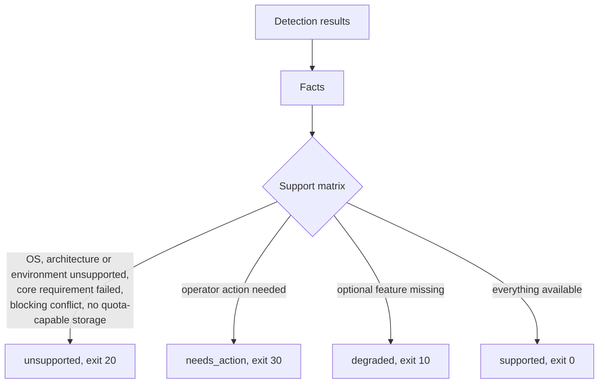

# How the preflight gate decides

Before anything is installed, `pinka-preflight` inspects the machine and
decides whether the lab can run on it. The decision is one of five
outcomes, each with its own exit code (see [Exit codes](../reference/exit-codes.md)):
`supported`, `degraded`, `unsupported`, `needs_action` and `preflight_error`.
Bootstrap acts on that outcome, and the full result is stored as the
[host profile](../reference/host-profile.md) in `/etc/pinka/host-profile.json`.

## Why a gate exists

The lab runs fault-injection experiments in nested sandboxes, serves a model
on a GPU, and must produce results that can be compared across sessions.
Hosts differ in ways that matter for all three: the kernel features that
Incus needs, whether KVM and a GPU are usable, and which storage backend can
enforce disk quotas. Detecting these up front keeps a half-working install
from producing results that look valid but are not.

## What is detected

| Area | Examples |
| --- | --- |
| Operating system | `os-release` fields, architecture, kernel release, whether PID 1 is systemd |
| Environment class | `baremetal`, `wsl2`, `wsl1`, `vm`, `container` or `unknown`, with a confidence and every signal used |
| Hardware | CPU threads (also under cgroup CPU limits), memory, free disk space for `/var/lib` and the research space |
| Kernel capabilities | cgroup v2 and its controllers, `overlay`, `br_netfilter`, `nf_tables`, `veth`, `/dev/net/tun`, KVM and nested virtualization, btrfs and LVM thin provisioning, Secure Boot, the MAC system |
| GPU | NVIDIA GPU, driver state, VRAM and compute capability, and whether the open kernel module of the pinned driver supports its PCI device ID (a driver is installed automatically only then); on WSL2 through the Windows driver |
| Conflicts | Docker Desktop integration, snap Docker, image-based or non-systemd systems, musl, a busy package manager, a Linux NVIDIA driver inside WSL, an unmanaged Incus |
| Pre-existing components | Docker Engine, Tailscale, LXD, Podman, Incus and the NVIDIA driver, each with its version and origin (`pinka` or `pre-existing`, from the install record); what pinka would need changed in one of them is `needs_action` ([Components that existed before pinka](pre-existing-components.md)) |
| Network | DNS and HTTPS reachability of the package mirrors, repositories and registries the install needs |

Every file read and every command run goes through two small interfaces, so
the same code runs against a fake root in tests. Preflight never changes the
host; on a real run as root it only stores its report.

## Classifying the environment

Several independent signals are collected and cross-checked: the kernel
release string, WSL devices and libraries, `systemd-detect-virt` (plain,
`--vm` and `--container`), the CPU `hypervisor` flag, DMI vendor strings and
container markers. WSL is checked first: recent systemd versions report `wsl`
from `systemd-detect-virt`, also with `--container`, and WSL must never be
treated as a container. When signals disagree, the classification keeps the
strongest signal, records the disagreement and lowers the confidence;
low confidence is a warning that the operator sees before continuing.

## From facts to an outcome

The decision logic is data: [`preflight/support-matrix.yml`](../support-matrix.md)
lists the distributions and their tiers, the architectures, the environment
classes, minimum hardware, core requirements, optional features and
provider-specific rules. The Python code only interprets it. This keeps the
rules readable and reviewable, and the same file renders the support matrix
page, so the documentation cannot drift from the behavior.

The outcomes have a fixed precedence: `unsupported`, then `needs_action`,
then `degraded`, then `supported`. One exception connects the first two: a
failed core requirement that an operator can fix is reported as
`needs_action`. The typical case is WSL2 without systemd: PID 1 is not
systemd only because `/etc/wsl.conf` does not enable it, so the fix is to
enable it and restart WSL, not to give up on the host.

**Tiers** are reported separately from the outcome. `supported` and `tested`
continue without extra consent; `experimental` needs `--accept-experimental`
or confirmation; rolling-release distributions add a reproducibility warning
because their installed versions drift between sessions.

**Storage** must support quotas. The Incus pool uses btrfs, or LVM thin
provisioning as a fallback. Without either the host is unsupported, because a
plain directory backend cannot stop a disk-exhaustion scenario from filling
the host disk.

## Why preflight uses only the standard library

Preflight must run before anything is installed, including on an old system
Python, and its result decides whether installation starts at all. It
therefore uses the Python standard library only and stays compatible with
Python 3.9. The rationale and the consequences are recorded in
[ADR-0001](../adr/0001-stdlib-only-preflight.md).

## How it is tested

Every supported decision path has a fixture: a fake root with the files and
command outputs of a particular kind of host (bare metal with a GPU, WSL2
without KVM, an immutable distribution, a host with cgroup v1, and so on).
The test suite runs preflight against each fixture, checks the outcome,
provider and features, validates the report against the host profile schema
and compares the human summary with a stored snapshot. Fixtures contain no
real host data; see [How to add a preflight fixture](../how-to/add-preflight-fixture.md).
