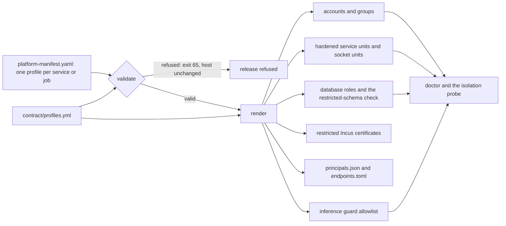

# Privilege profiles and restricted data

A platform is code that Pokus Infrastructure (pinka) deploys but does not
write. Its services run on the lab host next to the database, the telemetry
stores, Incus and the GPU, and one of them is the AI agent under test. Infra
therefore never asks a platform which privileges it wants. Each service and
each training job names one of eight *privilege profiles*, and infra turns
that profile, and nothing else, into accounts, groups, units, sockets, file
permissions, database roles and Incus certificates.

This page explains why the profiles are fixed, how a profile becomes real on
the host, how the agent and training jobs are isolated, how restricted data
is protected, and where infra's guarantees end. Every grant of every profile
is listed in [Platform privilege profiles](../reference/platform-profiles.md);
the manifest that names the profiles is described in
[Platform manifest](../reference/platform-manifest.md), and the interface as
a whole in the [integration contract](../contracts.md).

## Why fixed profiles

The obvious alternative is a manifest that lists the privileges each service
needs: this group, that socket directory, these database grants. Contract v2
does not allow that, for four reasons.

- **One source for every check.** `contract/profiles.yml` is the single
  source of the eight profiles, the socket connection rules and infra's caps.
  The manifest validator, the renderer, doctor, the generated reference page
  and the distribution tests' isolation probe all read the same flags, so
  what the reference promises is what the host gets and what the tests
  measure.
- **A review an operator can do.** An operator who deploys a release reviews
  one profile name per service, not a list of grants. The installer's
  platform review screen and `bootstrap.sh --inspect-platform` show each
  service with its profile, its account, its Incus projects and whether it
  reads restricted data, and they list the sockets dedicated to the agent.
- **No platform in infra's code.** Infra renders every platform from the
  same eight profiles, so a second platform fits without an infra change;
  the reference platform `refplat` exists to prove it.
- **"Never" can be enforced.** Because a profile is fixed, infra can refuse a
  manifest that asks for something the profile forbids and also take the
  grant away at run time, independently of what the platform's own code or
  migrations do.

A manifest can add only its own state directories, its secrets, limits
within infra's caps, and the one fixed relaxation `wx-memory` (which turns off
`MemoryDenyWriteExecute` for Quarto, and which the agent never gets).
Anything else is a validation error: the release is refused before anything
on the host changes, and bootstrap ends with exit code 65
([How to validate a platform release](../how-to/validate-a-platform-release.md)).

The price is coarseness. A service whose needs fall between two profiles
gets the broader one or is split in two, and a genuinely new combination is a
contract change with a contract version bump, never a local exception.

### "Never" and "none"

The profile table uses two words for a missing grant. *None* means the
profile has no such access to begin with: the agent has no database role, so
there is nothing to revoke. *Never* means infra refuses a manifest that would
give the access and also revokes it at run time: an `inference-broker` has a
database role, so it could in principle be granted the `restricted` schema by
a migration, and the check after every migration takes that grant away and
fails the deployment.

## From a manifest to the host

The deployment tool (`pinka-platform`, run by the `platform` role) validates
the manifest against the schema, the reserved names and the profile and
socket rules, then computes everything the profiles grant; the role applies
the result with ordinary Ansible modules. What each grant becomes:

| Grant | How infra renders it | What keeps it in place at run time |
| --- | --- | --- |
| Account | a system account `<platform>-<service>` or `<platform>-<job>`, shell `nologin`, locked password, a UID from the platform range 60578–61183 | the account's supplementary groups are set exactly (`append: false`), so a group added by hand is gone after the next deployment run |
| Groups | only from the profile: the client group of each socket it may use, `pinka-restricted` for profiles that read restricted data, `pinka-query` for profiles that query telemetry, `<platform>-db` for profiles with a database role; a job's only extra group is `pinka-datasets` | the rendering refuses any platform account in `root`, `wheel`, `sudo`, `adm`, `docker`, `incus`, `incus-admin`, `lxd`, `pinka` or `pinka-admin`, and the memberships listed under [Restricted data](#restricted-data) |
| Database | a login role `<platform>_<service>` in a group role `<platform>_<profile>`, so migrations can grant per profile; the migrator `<platform>_migrator` owns the schemas and is used only by the `migrate` hook, which runs as `<platform>-migrate` | the service socket directory `/run/pinka/postgres/` admits only the group `<platform>-db`; a profile without a role has the socket directories in its `InaccessiblePaths` |
| Incus | one restricted client certificate per service whose profile has Incus projects, in `/etc/pinka/incus/<account>/` (key 0600, owned by the account), trusted only for those projects | profiles without Incus access have `/etc/pinka/incus` in their `InaccessiblePaths`; the run-network helper's socket belongs to the controller and is hidden from every other profile |
| Telemetry | sending to the collector's OTLP receivers on the loopback; querying through the query proxy's socket `/run/pinka/query.sock` (group `pinka-query`) | the telemetry guard (`inet pinka_telemetry_guard`) resets every connection to Prometheus, Loki and Tempo except from infra's own clients, by UID |
| Inference and GPU | the inference API for `controller` and `inference-broker`; the GPU arbiter's socket `/run/pinka/gpu.sock` (0600) owned by the controller | the inference guard (`inet pinka_inference_guard`) resets every other account's connection to the API; the arbiter checks the caller's UID; every service unit has `PrivateDevices=yes`, so no service sees a GPU device |
| Restricted data | membership in `pinka-restricted` | see [Restricted data](#restricted-data) |
| Filesystem | the release read-only; the service's own configuration (`/etc/pinka/platform/config/<service>.json`, 0640 `root:<account>`), secrets (`/etc/pinka/secrets/<account>/`, 0640) and state directories (0700, owned by the account) | `ProtectSystem=strict` with `ReadOnlyPaths` and `ReadWritePaths` from the rendering; infra's internals (the Git mirrors and staging area, `/var/lib/incus`, Docker's socket and data, infra's container and backup secrets, `/etc/pinka/inference`, `/srv/pinka/backups`) in every unit's `InaccessiblePaths`, and the signing directory for every profile except `controller` |
| Network | loopback only for the service profiles that have network | `IPAddressDeny=any` with `IPAddressAllow=localhost`; `SocketBindDeny=any`, except the inference broker's one TCP port, the researcher endpoint (`127.0.0.1:18705` by default) |

Each service becomes the unit `<platform>-<service>.service` in
`pinka-platform.target`, with the hardening baseline of infra's
specification (no new privileges, no capabilities, `ProtectSystem=strict`,
private `/tmp` and devices, a system call filter, `UMask=0077` and more).
A manifest cannot override any of it; the only change it can ask for is
`wx-memory`.

The two telemetry and inference guards match the socket's UID, never its
group: a group can be shared (Grafana's container runs with group 0), a UID
names one account. [ADR-0016](../adr/0016-telemetry-query-isolation.md)
records why a UID allowlist in nftables is used rather than the stores' or
vLLM's own options. The inference guard resolves the platform's accounts each
time it loads, and the `platform` role reloads it after every deployment.

## Sockets between services

A platform's services talk to each other over Unix sockets that infra
creates, never over TCP. Each socket is a socket unit
`<platform>-<service>-<socket>.socket`: the socket file
`/run/pinka/platform/<service>/<socket>.sock` belongs to the serving
account, its group is a generated client group of the same name holding the
client service accounts, and its mode is 0660. Researchers and admins get
POSIX ACL entries for the groups `pinka` and `pinka-admin` where the
manifest lets them connect. systemd binds the socket and hands it to the
service by socket activation, so a service never binds a socket of its own.

Which profiles may connect to a socket depends on the profile that serves it
(the table is in the [reference](../reference/platform-profiles.md)). Two
rules matter most:

- Sockets served by `restricted-operator` and `restricted-reader` accept
  only the controller and root: the profiles that hold restricted data talk
  to nobody else.
- **Dedicated agent sockets.** A socket the agent may use is marked
  `untrusted_clients: true` and lists `untrusted-agent` as its only client.
  The validator refuses the flag together with any other client, profile or
  human, refuses the agent on a socket without the flag, and refuses the
  agent on any socket served by `restricted-operator`, `restricted-reader`
  or `observer`. A service that serves the agent and other clients
  therefore has separate sockets for them.

Without ACL support on `/run`, the ACL helper cannot add the human entries
and opens such a socket to 0666, so only the platform's peer-credential check
separates researchers, admins and services; doctor warns about each
(`sockets.acl_fallback`). A dedicated agent socket has no human clients, so
it never gets ACL entries and keeps mode 0660.

Infra writes `/etc/pinka/platform/principals.json` (every service and job
with its account and UID, every socket with its path and allowed clients) so
the platform builds its per-endpoint peer allowlists from data instead of
hard-coded names, and `/etc/pinka/platform/endpoints.toml` with the
addresses and paths infra provides.

## The untrusted agent

The `untrusted-agent` profile is for the agent under test, which is trusted
with nothing. Its unit carries the hardening baseline plus these additions:

- **No network.** `PrivateNetwork=yes` and `RestrictAddressFamilies=AF_UNIX`:
  the agent has only a loopback of its own and can use only Unix sockets.
- **An allowlisted file system.** `/srv/pinka`, `/etc/pinka`,
  `/var/lib/pinka` and `/run/pinka` are replaced by empty read-only temporary
  file systems. Bound into them read-only: its own package and its own
  environment of the release, its own configuration file, its dedicated
  sockets and the agent OTLP socket. Bound read-write: its state directories
  and its runtime directory. Infra's internals are also inaccessible, since
  some of them (`/var/lib/incus`, Docker's socket and data) lie outside
  those four directories.
- **Only its own package.** The agent's service names its own package in
  the manifest; it runs from the release directory itself, never through the
  `current` link, and sees only that package and its environment
  (`.agent-venvs/<service>/` for `python-uv`): no other package, migrations,
  policy bundle, documentation or dashboards. Its environment is built from
  its own locked dependencies only, and a dependency on another package of
  the release, or on a path, Git or URL source, refuses the release.
- **No database.** No login role is created for it, and it never joins
  `<platform>-db`; the database socket directories are not in its view.
- **No secrets, no relaxation, no other groups.** The validator refuses
  secrets and relaxations for the profile, and the rendering refuses any
  supplementary group except the client groups of its dedicated sockets.
- **Its own telemetry socket.** It cannot reach the collector's OTLP
  receivers. It sends only through `/run/pinka/otlp/agent.sock`, and the
  collector stamps everything that arrives there with
  `pinka.trust=untrusted`, overwriting what the sender set. It cannot query
  telemetry.
- **Inference only through a broker.** It has no direct inference API;
  the platform may give it a dedicated socket on its controller,
  inference broker or sandbox operator.

The agent never has Incus access either: what it does to a target goes
through the platform's own services
([How benchmark targets are isolated](target-isolation.md)).

## Training jobs

The `gpu-trainer` profile exists only for the manifest's `jobs[]`; no
service may use it. A job is not a systemd service of the platform but a
container that the GPU arbiter runs as `pinka-gpu-job@<run>.service`, with
options fixed in the arbiter that no manifest field can change: no network
(`--network none`), a read-only root file system with a private `/tmp`, no
capabilities, no new privileges, a private IPC namespace, the job's own
account `<platform>-<job>` with `pinka-datasets` as its only extra group, and
the manifest's memory and CPU limits within infra's caps.

A job sees exactly what is mounted: the base model and the published
datasets read-only, and the run's output and checkpoint directories
read-write. It has no database role, no Incus access, no telemetry (progress
goes to the job log and a metrics file in its output directory) and no
sockets. It gets the GPU through CDI only while the arbiter is in training
mode for this run, and `gpu-trainer` is the only profile that ever gets GPU
devices; vLLM, which infra runs, is the other GPU user, and the arbiter keeps
the two apart. How runs, datasets and adapters work is explained in
[The GPU arbiter](gpu-arbiter.md).

## Restricted data

Restricted data is data the agent must never see, such as a scenario's ground
truth. Infra does not know what it means for a given platform; it provides
one generic class of storage for it, with three parts:

| Part | Value |
| --- | --- |
| Area | `/srv/pinka/restricted/<platform>/`, owned `root:pinka-restricted`, directories 0750, files 0640; restricted content packages under `content/<package>/<name>/`, where `<name>` is the tag or the full commit |
| Group | `pinka-restricted`, an infra group; infra puts in it only the accounts of `controller`, `restricted-operator` and `restricted-reader` services |
| Database schema | `restricted` in the platform's database, owned by the migrator role |

Content packages the manifest declares `restricted: true` are restricted
data; the Pokus Platform's scenario catalog is one. Only root writes the
area: the members of `pinka-restricted` read it.

### Enforced regardless of the manifest

These rules hold whatever the manifest, the platform's code or its
migrations do:

- **Memberships.** The rendering derives every membership from the profile
  grants and then re-checks the result: an `untrusted-agent` or
  `gpu-trainer` account in `pinka-restricted`, `pinka-query` or
  `<platform>-db` is refused, even if the data asked for it.
- **Files.** Every profile without restricted data has
  `/srv/pinka/restricted` in its unit's `InaccessiblePaths`; the agent's
  allowlist does not contain it; the arbiter's fixed mount list never
  includes it in a training container.
- **Sockets.** No socket served by a `restricted-*` profile has a client
  other than the controller and root.
- **The schema.** After the database bootstrap and after every `migrate`
  hook, infra lists and revokes every privilege that reaches schema
  `restricted` from a role outside the migrator and the roles of the three
  restricted-capable profiles: privileges on the schema and on every object
  in it, default privileges, views outside the schema that read it,
  `SECURITY DEFINER` functions of allowed roles outside it, and role
  memberships. The researchers' reader role and the Grafana role are never
  allowed. A grant that a migration made to a forbidden role is revoked and
  fails the deployment: the new release does not start.
- **Deployment.** Restricted packages are extracted only into the restricted
  area, never into the release directory or the platform's state. A content
  package in the same repository as the release must not overlap the
  release's path, otherwise it could be extracted as part of the release.
  The build sandbox never sees `/srv/pinka/restricted`.
- **Backups.** The restricted area is always in the backup set; the local
  database dumps lie in a root-only directory (0700), and `/srv/pinka/backups`
  is inaccessible to every platform unit.
- **Training.** Data derived from restricted data reaches a training job only
  as a dataset that the arbiter published after its split guard: no dataset
  that lists an instance of the `test` split is published or mounted.

### What only the platform can guarantee

Two things are beyond what infra can see:

- **Dedicated agent sockets return no restricted data.** The controller
  reads restricted data and may also serve the agent on a dedicated socket;
  the separation between the two happens in the platform's own code. Infra
  makes these sockets visible (the installer's review screen,
  `--inspect-platform` and doctor's `sockets.permissions` list each one) but
  cannot inspect what they return. The platform's specification obliges it,
  and a platform test must prove it.
- **Dataset provenance is complete and truthful.** The arbiter checks the
  `PROVENANCE.json` it is given (hashes, no `test` instance) but cannot verify
  it against the restricted data the platform derived it from.

## How it is checked

Doctor checks the rendered result on the running host; the checks are
defined from the profiles and the manifest, never from a platform's name
([Doctor checks](../reference/doctor-checks.md)):

- `platform.manifest`: the active release still validates, and its hash is
  recorded.
- `systemd.hardening`: each platform unit's effective properties
  (`systemctl show`), address families and inaccessible paths are those of
  its profile.
- `sockets.permissions`: every socket has its rendered owner, group, mode and
  ACL entries; the dedicated agent sockets are listed.
- `sockets.agent_view`: walking the running agent's file system through
  `/proc/<pid>/root`, it sees no socket beyond its allowlist and nothing of the
  release beyond its own package and environment.
- `postgres.roles`: the reader and Grafana roles cannot use schema
  `restricted`.
- `deploy.provenance`: no `.git` in deployed paths, and no restricted
  package's provenance record outside the restricted area.
- `telemetry.isolation` and `inference.isolation`: the loaded guards admit
  exactly the accounts they should.
- `training.containers` and `training.datasets`: a running job has the fixed
  options and only its mounts; published datasets match their hash and list
  no `test` instance.

The distribution tests (`make test-distros`) prove the isolation on real
hosts with the reference platform
([How to test the distributions](../how-to/test-distributions.md)). Its
isolation probe tries everything a platform account should not be able to
do: list the restricted area and content, infra's secrets, the Git mirrors
and the datasets area; connect to the database, GPU arbiter, run-network
helper and query proxy sockets, to the telemetry stores and the inference
API, to the platform's sockets and to an address outside the host; write to
the platform's state and to its own environment.

- The agent runs the probe as itself and reports to its controller; it must
  reach nothing.
- For every service profile with loopback access, the harness runs the probe
  as a transient unit with that profile's rendered hardening and groups: as
  the service's own account where the reference platform has one, otherwise
  as a temporary account from the platform UID range. The expectations come
  from the profile flags in `contract/profiles.yml`: no profile reaches
  Prometheus, Loki or Tempo directly; the query proxy answers exactly the
  profiles that query; the inference API answers only the controller and
  the inference broker; the GPU arbiter's and the run-network helper's
  sockets answer only the controller.
- After a platform replacement, the renamed copy's agent must again reach
  nothing.

An expectation is never loosened to make a test pass; a difference is a
defect in the rendering or in the contract.

Related: [Platform privilege profiles](../reference/platform-profiles.md),
[integration contract](../contracts.md),
[The GPU arbiter](gpu-arbiter.md),
[How benchmark targets are isolated](target-isolation.md),
[Security of the lab host](../security.md).
