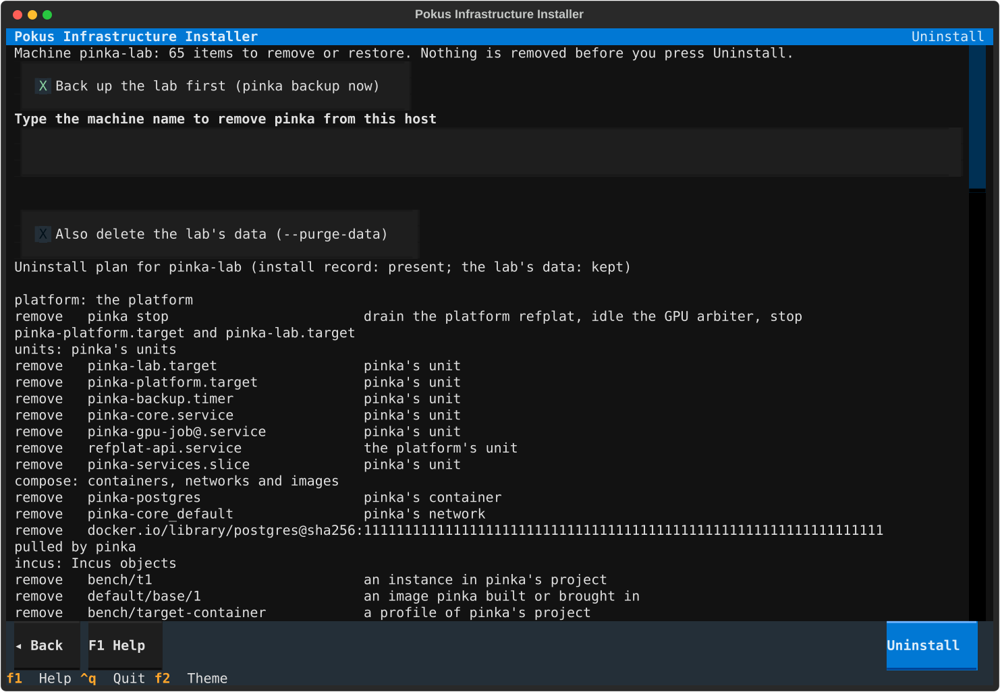

# How to uninstall pinka

Uninstall removes what pinka installed and sets back what it changed. The
plan comes from the install record (`/var/lib/pinka/install-record.json`)
and the host as it is now, and it is removed in this order: the platform,
pinka's units, its containers and images, its Incus objects, its firewall
tables, the Tailscale node pinka joined, the packages, holds, repositories
and keys pinka added, its accounts, groups, memberships and keys, its
drop-in files and settings, and its paths, with the install record last.

Uninstall keeps everything the record lists as there before pinka: Docker
Engine, Tailscale, LXD, Podman, Incus, an NVIDIA driver, accounts, packages
and the machine's access (see
[Components that existed before pinka](../explanation/pre-existing-components.md)).
Without `--purge-data` it also keeps the lab's data, wherever it lives:

| What | Where |
| --- | --- |
| The database, the telemetry stores (Prometheus, Loki, Tempo, Grafana) | `/srv/pinka/state/<service>/`: every container of pinka's keeps its data in a bind mount there, none in a Docker volume |
| Models, registered adapters, datasets, training runs | `/srv/pinka/models/`, `/srv/pinka/models/adapters/`, `/srv/pinka/datasets/`, `/srv/pinka/training/` |
| The platforms' releases, state and restricted data; golden images; shared files, the published signing keys, the researchers' directories | `/srv/pinka/platforms/`, `/srv/pinka/restricted/`, `/srv/pinka/images/`, `/srv/pinka/shared/` (`shared/signing-keys/`), `/srv/pinka/users/` |
| Local backup staging (database dumps) | `/srv/pinka/backups/` |
| The data of a Docker, Incus or Tailscale pinka installed | Docker's data root (what `docker info` names, `/var/lib/docker` by default) and `/var/lib/containerd`; `/var/lib/incus`; `/var/lib/tailscale` |
| A researcher's personal Incus project with instances or volumes | the project, its network and its storage pool; Incus itself stays installed for it |
| The researchers' homes | `/home/<name>` |
| Records, attestations, verification results | copied to `/var/lib/pinka-kept/qa/` and `/var/lib/pinka-kept/records/` before `/etc/pinka` and `/var/lib/pinka` go |
| The backups' key and settings, the restic binary, the vault password bootstrap stored | copied to `/var/lib/pinka-kept/backup/` and `/var/lib/pinka-kept/vault-pass`, also with `--purge-data` |
| The logs; the backups | `/var/log/pinka-bootstrap`, `/var/log/pinka-uninstall`; the restic repository, wherever it is |

While packages are removed, the kept data directories are mounted read-only,
so that no package's removal script can delete them, and a package whose
purge deletes data (Tailscale's, Incus's `incus-base`) is removed without
purging. When a directory cannot be guarded, no package is removed.

!!! note "Prerequisites"
    - Root on the lab host (`sudo`).
    - The checkout or the unpacked release package the lab was installed
      from; `pinka uninstall` finds it in `/etc/pinka/bootstrap-state.json`.
    - A terminal, or the machine name to pass with `--confirm-machine`.
    - No experiment you still need is running: uninstall's first step
      drains the platform and stops the lab.

## Look at the plan

1. Print the plan; nothing changes:

    <!-- qa:run env=E2 -->
    ```bash
    sudo pinka uninstall --dry-run
    ```

    ```text title="Output (shortened)"
    Uninstall plan for lab1 (install record: present; the lab's data: kept)

    units: pinka's units
      remove   pinka-lab.target                  pinka's unit
    firewall: firewall
      remove   inet pinka_filter                 pinka's table
      remove   inet pinka_access_guard           the access guard: listeners closed with consent are reachable again
    dropins: drop-in files and settings
      remove   /etc/ssh/sshd_config.d/10-pinka.conf  pinka wrote it
      restore  /etc/ssh/sshd_config              the line pinka added goes: Include /etc/ssh/sshd_config.d/*.conf
    ...
    Kept:
      keep     /srv/pinka                        the lab's data: ...; --purge-data removes it

    59 to remove, 4 to restore, 6 kept.
    ```

2. Read each phase: `remove` items go, `restore` items are set back as they
   were before pinka (a file, a setting, a membership, a service's state),
   and the `Kept:` list says why each item stays. A line `Refused:` means
   uninstall would stop here; [exit code 80](troubleshoot.md#exit-code-80)
   says what to do.

## Uninstall

1. Run uninstall:

    <!-- qa:skip reason="removes the lab from the host" -->
    ```bash
    sudo pinka uninstall
    ```

    It shows the plan again. When a restic repository is configured it
    offers a backup first (`pinka backup now`; `--skip-backup` does not
    offer it), and a failed backup stops it before anything is removed. Then
    type the machine name the plan shows. Without a terminal, pass the name:

    <!-- qa:skip reason="removes the lab from the host" -->
    ```bash
    sudo pinka uninstall -- --non-interactive --confirm-machine <machine>
    ```

    `<machine>` is the machine name in the plan's first line. From the
    checkout, `sudo ./bootstrap/bootstrap.sh --uninstall` does the same;
    the installer offers it as *Uninstall pinka from this host* on its
    *Install mode* screen, then shows the dry run, the backup offer and the
    machine name fields:

    

2. If you are connected over the tailnet and pinka joined the node, logging
   the node out ends your session. Uninstall goes on without its terminal;
   connect again another way and read the report.

3. Read the last lines. `reboot needed:` says why the host needs a
   reboot (the initramfs was rebuilt without pinka's nouveau blacklist, a
   Machine Owner Key to delete, WSL's `/etc/wsl.conf` set back): reboot
   then, since uninstall never reboots. `kept backups:` names the kept key
   (see [Open the backups afterwards](#open-the-backups-afterwards)).

4. Do what the lines `afterwards:` name, the first one first:
   [take the kept secrets off the host](#take-the-kept-secrets-off-the-host);
   delete the node in the Tailscale admin console (*Machines*) when pinka
   joined it, since a logout does not take it off the tailnet; and revoke
   the platform's read-only deploy key on its Git host.

## Take the kept secrets off the host

`/var/lib/pinka-kept` holds the restic repository's password and location,
the SFTP key of the backup server and the vault password bootstrap stored
(each when the lab had it), next to the backup server's host keys, the
restic binary, the records and the attestations. The password and the key
grant access to the backups, and the vault password opens the vault that
holds the repository's password. Uninstall keeps them so the backups stay
usable; they should not stay on this host.

1. Copy the directory off the host, as a stream so that no other copy lands
   on its disk:

    <!-- qa:skip reason="runs after the lab was removed" -->
    ```bash
    sudo tar -C /var/lib -cf - pinka-kept | ssh <you>@<safe-host> 'umask 077; cat > pinka-kept.tar'
    ```

    `<you>@<safe-host>` is an account on a machine you trust; removable media
    works as well (`sudo cp -a /var/lib/pinka-kept /media/<stick>/`).

2. Check the copy there (`tar -tvf pinka-kept.tar` lists
   `pinka-kept/backup/secrets/password`), then delete the directory here:

    <!-- qa:skip reason="deletes the kept secrets" -->
    ```bash
    sudo find /var/lib/pinka-kept -type f -exec shred -u {} +
    sudo rm -rf /var/lib/pinka-kept
    ```

3. On an SSD or a copy-on-write file system (btrfs), `shred` cannot reach
   every old copy of a file. There, also change the repository's password
   from the copy (`restic key passwd`) and replace the SFTP key on the backup
   server.

## Also delete the lab's data

Add `--purge-data` to remove the lab's data as well: `/srv/pinka`, the data
of the components pinka installed (for example `/var/lib/docker`), and the
homes of the researchers pinka created. Uninstall asks for the machine name
a second time. The backups stay.

<!-- qa:skip reason="deletes the lab's data" -->
```bash
sudo pinka uninstall --purge-data
```

## Open the backups afterwards

Uninstall never deletes the backups, and keeps what opens them in
`/var/lib/pinka-kept` (root only, also with `--purge-data`): the
repository's location, its password and the SFTP key, the backup server's
host keys and the restic binary they were written with.
`/var/lib/pinka-kept/README.txt` repeats these commands; run them before you
[take the kept secrets off the host](#take-the-kept-secrets-off-the-host), or
from the copy:

<!-- qa:skip reason="runs after the lab was removed" -->
```bash
sudo env RESTIC_REPOSITORY_FILE=/var/lib/pinka-kept/backup/secrets/repository \
  RESTIC_PASSWORD_FILE=/var/lib/pinka-kept/backup/secrets/password \
  /var/lib/pinka-kept/backup/restic snapshots
```

For an SFTP repository, add
`-o sftp.args='-i /var/lib/pinka-kept/backup/secrets/ssh_key -o IdentitiesOnly=yes -o StrictHostKeyChecking=yes -o UserKnownHostsFile=/var/lib/pinka-kept/backup/config/known_hosts'`
before `snapshots`. The public halves of the platforms' signing keys stay in
`/srv/pinka/shared/signing-keys/`.

## Uninstall from a host without an install record

On a host whose install never wrote a record (an install interrupted early,
or one from before the record existed), uninstall removes only what carries
pinka's names, and keeps Docker Engine, Incus, Tailscale and an NVIDIA
driver with the reason "origin unknown". Name each component pinka installed
to remove it too:

<!-- qa:skip reason="removes components from the host" -->
```bash
sudo ./bootstrap/bootstrap.sh --uninstall --machine <machine> --remove-component docker --remove-component incus
```

`<machine>` is the name the host was installed as. `--remove-component`
takes `docker`, `incus`, `tailscale` or `nvidia`, and is refused on a host
with a record, which already says what pinka installed.

## Read the report

Every run that removed something writes a report, readable by root only:

<!-- qa:run env=E2 -->
```bash
sudo ls -t /var/log/pinka-uninstall/
```

The newest file lists every item of the plan with its result: `removed`,
`restored`, `kept` (with the reason), `already_gone` or `failed`; and
`reboot_needed` with its `reboot_reasons`, `backup_access` (where the kept
key is) and `follow_ups` (what to do outside the host). `--json`
prints the plan (with `--dry-run`) or the report on standard output
instead. Bootstrap ends with exit code 0 when everything went as planned,
[80](troubleshoot.md#exit-code-80) when uninstall was refused or not
confirmed (nothing was removed), and [81](troubleshoot.md#exit-code-81) when
items could not be removed.

## Verify the result

Uninstall can run again at any time: what is already gone is reported as
such. After a complete uninstall, `pinka` itself is gone; from the checkout,
a dry run finds nothing left to remove or restore:

<!-- qa:skip reason="runs after the lab was removed" -->
```bash
sudo ./bootstrap/bootstrap.sh --uninstall --dry-run
```

```text title="Output (the plan's last line)"
0 to remove, 0 to restore, 4 kept.
```

The kept items are the lab's data, the two log directories and
`/var/lib/pinka-kept`.
