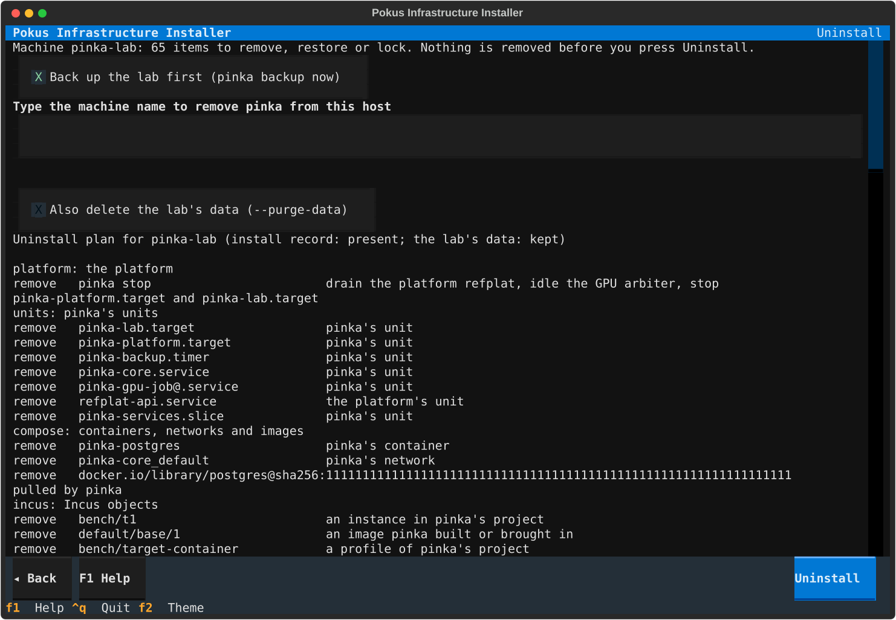

# How to uninstall pinka

Uninstall removes what pinka installed and sets back what it changed. The
plan comes from the install record (`/var/lib/pinka/install-record.json`)
and the host as it is now, and it is removed in this order: the platform,
pinka's units, its containers and images, its Incus objects, its firewall
tables, the Tailscale node pinka joined, the packages, holds, repositories
and keys pinka added, the memberships and keys pinka added to accounts that
were there before it, its drop-in files and settings, and its paths. Its
own records go last: `/etc/pinka` (with the machine name and the lab's
description) and pinka's state with the install record, and only when
everything before them went, so that a run that did not finish can run
again and finish.

Uninstall keeps everything the record lists as there before pinka: Docker
Engine, Tailscale, LXD, Podman, Incus, an NVIDIA driver, accounts, packages
and the machine's access (see
[Components that existed before pinka](../explanation/pre-existing-components.md)).
Without `--purge-data` it also keeps the lab's data, wherever it lives:

| What | Where |
| --- | --- |
| The database, the telemetry stores (Prometheus, Loki, Tempo, Grafana) | `/srv/pinka/state/<service>/`: every container of pinka's keeps its data in a bind mount there, none in a Docker volume |
| Models, registered adapters, datasets, training runs | `/srv/pinka/models/`, `/srv/pinka/models/adapters/`, `/srv/pinka/datasets/`, `/srv/pinka/training/` |
| The platforms' releases, state and restricted data; golden images; shared files, the published signing keys, the researchers' directories | `/srv/pinka/platforms/`, `/srv/pinka/restricted/`, `/srv/pinka/images/`, `/srv/pinka/shared/` (`shared/signing-keys/`), `/srv/pinka/users/` |
| Local backup staging (database dumps) | `/srv/pinka/backups/` |
| The data of a Docker, Incus or Tailscale pinka installed | Docker's data root (what `docker info` names, `/var/lib/docker` by default) and `/var/lib/containerd`; `/var/lib/incus`; `/var/lib/tailscale` |
| A researcher's personal Incus project with instances or volumes | the project, its network and its storage pool; Incus itself stays installed for it |
| The accounts and groups that own the data: pinka's, the platforms', the researchers' | kept, the accounts locked: the password locked, a login shell that lets nobody in, expired; noted in `/var/lib/pinka/kept-accounts.json` (root only) |
| The researchers' homes | `/home/<name>` |
| Records, attestations, verification results | copied to `/var/lib/pinka-kept/qa/` and `/var/lib/pinka-kept/records/` before `/etc/pinka` and `/var/lib/pinka` go |
| The backups' key and settings, the restic binary, the vault password bootstrap stored | copied to `/var/lib/pinka-kept/backup/` and `/var/lib/pinka-kept/vault-pass`, also with `--purge-data` |
| The logs; the backups | `/var/log/pinka-bootstrap`, `/var/log/pinka-uninstall`; the restic repository, wherever it is |

While packages are removed, the kept data directories are mounted read-only,
so that no package's removal script can delete them, and a package whose
purge deletes data (Tailscale's, Incus's `incus-base`) is removed without
purging. When a directory cannot be guarded, no package is removed.

Because the accounts and groups stay with the data, no UID or GID that owns
a kept file becomes free for another account: the data keeps its owners,
and nobody logs in as them. The lab root is also locked to root
(root:root 0700 without ACL entries) as an extra defense; the files inside
keep their owners, groups, modes and ACLs. When the lab root cannot be
locked (it is a system directory, or a directory above it is open to other
accounts), the plan and the report say why, and uninstall goes on. If the
lab root's file system was not mounted when uninstall ran, the lock is on
the empty mount point: lock the lab root yourself once it is mounted
(`chown root:root`, `chmod 0700`, `setfacl -b`). A lab root whose lock
failed while uninstall ran (a read-only file system, for example) counts as
`1 to lock` in every later plan, until it is locked.

!!! note "Prerequisites"
    - Root on the lab host (`sudo`).
    - The checkout or the unpacked release package the lab was installed
      from; `pinka uninstall` finds it in `/etc/pinka/bootstrap-state.json`.
    - A terminal, or the machine name to pass with `--confirm-machine`.
    - No experiment you still need is running: uninstall's first step
      drains the platform and stops the lab.

## Look at the plan

1. Print the plan; nothing changes:

    <!-- qa:run env=E2 -->
    ```bash
    sudo pinka uninstall --dry-run
    ```

    ```text title="Output (shortened)"
    Uninstall plan for lab1 (install record: present; the lab's data: kept)

    units: pinka's units
      remove   pinka-lab.target                  pinka's unit
    firewall: firewall
      remove   inet pinka_filter                 pinka's table
      remove   inet pinka_access_guard           the access guard: listeners closed with consent are reachable again
    accounts: accounts, groups, memberships and keys
      lock     /srv/pinka                        the lab's data: its top locked to root (root:root 0700 without ACL entries) as an extra defense; ...
      remove   owner1 in pinka                   pinka added it
      lock     pinka-postgres                    pinka created it; kept with the lab's data, locked: ...
      lock     researcher1                       pinka created it; kept with the lab's data, locked: ...
    dropins: drop-in files and settings
      remove   /etc/ssh/sshd_config.d/10-pinka.conf  pinka wrote it
      restore  /etc/ssh/sshd_config              the line pinka added goes: Include /etc/ssh/sshd_config.d/*.conf
    ...
    Kept:
      keep     pinka                             pinka created it; kept with the lab's data, so its GID stays taken; ...
      keep     /srv/pinka                        the lab's data: ...; --purge-data removes it

    59 to remove, 4 to restore, 20 to lock, 33 kept.
    ```

2. Read each phase: `remove` items go, `restore` items are set back as they
   were before pinka (a file, a setting, a membership, a service's state),
   `lock` items are the accounts that stay locked with the data and the
   lab root locked to root, and the `Kept:` list says why each item stays. A line `Refused:` means
   uninstall would stop here; [exit code 80](troubleshoot.md#exit-code-80)
   says what to do.

## Uninstall

1. Run uninstall:

    <!-- qa:skip reason="removes the lab from the host" -->
    ```bash
    sudo pinka uninstall
    ```

    It shows the plan again. When a restic repository is configured it
    offers a backup first (`pinka backup now`; `--skip-backup` does not
    offer it), and a failed backup stops it before anything is removed. Then
    type the machine name the plan shows. Without a terminal, pass the name:

    <!-- qa:skip reason="removes the lab from the host" -->
    ```bash
    sudo pinka uninstall -- --non-interactive --confirm-machine <machine>
    ```

    `<machine>` is the machine name in the plan's first line. From the
    checkout, `sudo ./bootstrap/bootstrap.sh --uninstall` does the same;
    the installer offers it as *Uninstall pinka from this host* on its
    *Install mode* screen, then shows the dry run, the backup offer and the
    machine name fields:

    

2. If you are connected over the tailnet and pinka joined the node, logging
   the node out ends your session. Uninstall goes on without its terminal;
   connect again another way and read the report.

3. Read the last lines. `reboot needed:` says why the host needs a
   reboot (the initramfs was rebuilt without pinka's nouveau blacklist, a
   Machine Owner Key to delete, WSL's `/etc/wsl.conf` set back): reboot
   then, since uninstall never reboots. `kept backups:` names the kept key
   (see [Open the backups afterwards](#open-the-backups-afterwards)).

4. Do what the lines `afterwards:` name, the first one first. When
   uninstall did not finish, that line says so: see
   [If uninstall did not finish](#if-uninstall-did-not-finish). Then
   [take the kept secrets off the host](#take-the-kept-secrets-off-the-host);
   delete the node in the Tailscale admin console (*Machines*) when pinka
   joined it, since a logout does not take it off the tailnet; and revoke
   the platform's read-only deploy key on its Git host. A locked account
   whose session was open before the lock still runs its processes: end
   them (`sudo pkill -KILL -u <account>`); locking does not end a session.

## If uninstall did not finish

When an item could not be removed or locked (bootstrap ends with
[exit code 81](troubleshoot.md#exit-code-81)), uninstall keeps its own
records: `/etc/pinka` with the machine name and the lab's description, and
`/var/lib/pinka` with the install record and the note of the kept accounts.
Deal with each failed item the report names, then run uninstall again; it
takes the plan from these records and finishes. Only a run in which nothing
before them failed removes them.

## Take the kept secrets off the host

`/var/lib/pinka-kept` holds the restic repository's password and location,
the SFTP key of the backup server and the vault password bootstrap stored
(each when the lab had it), next to the backup server's host keys, the
restic binary, the records and the attestations. The password and the key
grant access to the backups, and the vault password opens the vault that
holds the repository's password. Uninstall keeps them so the backups stay
usable; they should not stay on this host.

1. Copy the directory off the host, as a stream so that no other copy lands
   on its disk:

    <!-- qa:skip reason="runs after the lab was removed" -->
    ```bash
    sudo tar -C /var/lib -cf - pinka-kept | ssh <you>@<safe-host> 'umask 077; cat > pinka-kept.tar'
    ```

    `<you>@<safe-host>` is an account on a machine you trust; removable media
    works as well (`sudo cp -a /var/lib/pinka-kept /media/<stick>/`).

2. Check the copy there (`tar -tvf pinka-kept.tar` lists
   `pinka-kept/backup/secrets/password`), then delete the directory here:

    <!-- qa:skip reason="deletes the kept secrets" -->
    ```bash
    sudo find /var/lib/pinka-kept -type f -exec shred -u {} +
    sudo rm -rf /var/lib/pinka-kept
    ```

3. On an SSD or a copy-on-write file system (btrfs), `shred` cannot reach
   every old copy of a file. There, also change the repository's password
   from the copy (`restic key passwd`) and replace the SFTP key on the backup
   server.

## Also delete the lab's data

Add `--purge-data` to remove the lab's data as well, and with it the
accounts and groups that own it: `/srv/pinka`, the data of the components
pinka installed (for example `/var/lib/docker`), the accounts and groups
pinka and the platforms created, and the homes of the researchers pinka
created. Accounts, groups and data go only together. Uninstall asks for the
machine name a second time. The backups stay.

<!-- qa:skip reason="deletes the lab's data" -->
```bash
sudo pinka uninstall --purge-data
```

After an uninstall without it, `pinka` is gone; run it from the checkout,
with the machine name the host was installed as (the state file that
recorded it is gone). Uninstall reads the kept accounts, the groups and the
lab root from `/var/lib/pinka/kept-accounts.json`. Without the install
record it cannot tell which components pinka installed: name each with
`--remove-component` (`docker`, `incus`, `tailscale`, `nvidia`), or it
stays, with its data, and so do Docker's and Incus's groups (`docker`,
`incus`, `incus-admin`):

<!-- qa:skip reason="deletes the lab's data" -->
```bash
sudo ./bootstrap/bootstrap.sh --uninstall --purge-data --machine <machine> --remove-component docker --remove-component incus
```

`<machine>` is the name this host was installed as; leave out the
components pinka did not install.

## Install again on this host

To bring the lab's data into a new lab, restore it from the backups. Before
you install pinka on this host again, move the kept lab root away or delete
it on purpose: nothing takes the kept data over yet. The install then
takes the kept accounts and groups over from
`/var/lib/pinka/kept-accounts.json` (each that still has its noted UID or
GID): they are pinka's again, and the play names them. The lock of an
account the lab names again is undone as noted, right before the account
is managed: infra's accounts and the researchers in `researchers`
(`users_groups`), and the accounts of the platform it deploys. The login
shell and the expiry come back as they were, and the password is unlocked
only where uninstall locked it. A kept account the lab no longer names (a
researcher left out of `researchers`, a replaced platform's account)
stays locked: add it again to bring it back, or remove it with a later
uninstall with `--purge-data`. A researcher named again gets that account
back as it was, with its home, its password and its keys: give a new
person a new name. An account whose lock someone changed since is left as
it is. The note counts only as a regular file of root's that
nobody else can write: the install stops at another one, and uninstall
ignores it with a warning.

## Open the backups afterwards

Uninstall never deletes the backups, and keeps what opens them in
`/var/lib/pinka-kept` (root only, also with `--purge-data`): the
repository's location, its password and the SFTP key, the backup server's
host keys and the restic binary they were written with.
`/var/lib/pinka-kept/README.txt` repeats these commands; run them before you
[take the kept secrets off the host](#take-the-kept-secrets-off-the-host), or
from the copy:

<!-- qa:skip reason="runs after the lab was removed" -->
```bash
sudo env RESTIC_REPOSITORY_FILE=/var/lib/pinka-kept/backup/secrets/repository \
  RESTIC_PASSWORD_FILE=/var/lib/pinka-kept/backup/secrets/password \
  /var/lib/pinka-kept/backup/restic snapshots
```

For an SFTP repository, add
`-o sftp.args='-i /var/lib/pinka-kept/backup/secrets/ssh_key -o IdentitiesOnly=yes -o StrictHostKeyChecking=yes -o UserKnownHostsFile=/var/lib/pinka-kept/backup/config/known_hosts'`
before `snapshots`. The public halves of the platforms' signing keys stay in
`/srv/pinka/shared/signing-keys/`.

## Uninstall from a host without an install record

On a host whose install never wrote a record (an install interrupted early,
or one from before the record existed), uninstall removes only what carries
pinka's names, and keeps Docker Engine, Incus, Tailscale and an NVIDIA
driver with the reason "origin unknown". Name each component pinka installed
to remove it too:

<!-- qa:skip reason="removes components from the host" -->
```bash
sudo ./bootstrap/bootstrap.sh --uninstall --machine <machine> --remove-component docker --remove-component incus
```

`<machine>` is the name the host was installed as. `--remove-component`
takes `docker`, `incus`, `tailscale` or `nvidia`, and is refused on a host
with a record, which already says what pinka installed.

## Read the report

Every run that removed something writes a report, readable by root only:

<!-- qa:run env=E2 -->
```bash
sudo ls -t /var/log/pinka-uninstall/
```

The newest file lists every item of the plan with its result: `removed`,
`restored`, `locked`, `kept` (with the reason), `already_gone` or `failed`; and
`reboot_needed` with its `reboot_reasons`, `backup_access` (where the kept
key is) and `follow_ups` (what to do outside the host). `--json`
prints the plan (with `--dry-run`) or the report on standard output
instead. Bootstrap ends with exit code 0 when everything went as planned,
[80](troubleshoot.md#exit-code-80) when uninstall was refused or not
confirmed (nothing was removed), and [81](troubleshoot.md#exit-code-81) when
items could not be removed or locked.

## Verify the result

Uninstall can run again at any time: what is already gone is reported as
such. After a complete uninstall, `pinka` itself is gone; from the checkout,
a dry run finds nothing left to remove, restore or lock:

<!-- qa:skip reason="runs after the lab was removed" -->
```bash
sudo ./bootstrap/bootstrap.sh --uninstall --dry-run
```

```text title="Output (the plan's last line, for example)"
0 to remove, 0 to restore, 0 to lock, 33 kept.
```

The kept items are the lab's data, its locked accounts and groups and their
note, the two log directories and `/var/lib/pinka-kept`.
