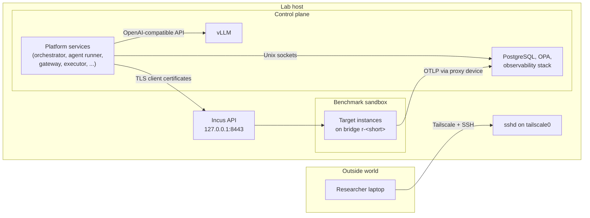

# Lab host architecture

A Pokus lab is one Linux host that runs everything: the shared lab services,
the research platform, local inference, and the sandbox in which benchmark
targets are broken and repaired. This page describes the host as pokus-infra
builds it. The platform's services are described in the platform's own
architecture page; the interface between the two is the
[integration contract](contracts.md).

## Trust zones

The host is divided into zones that trust each other in one direction only.
Each zone boundary is enforced by an operating system mechanism, not by
convention.

| Zone | What runs there | Boundary |
| --- | --- | --- |
| Outside world | the Windows side of a WSL2 host, the LAN, the internet | Tailscale only; no public ports, never Funnel; WSL interop disabled |
| Lab host | the operating system, Docker, Incus, systemd units | root only; researchers reach it over SSH on `tailscale0` |
| Control plane | platform services as separate service accounts, PostgreSQL, OPA, the observability stack, vLLM | Unix sockets with group, ACL and peer-credential checks; services listen on `127.0.0.1` |
| Benchmark sandbox | Incus instances of a run, one bridge `r-<short>` per run | Incus projects and ACLs; no uplink, no route out of the run network |
| Personal sandboxes | researchers' own Incus projects and `/srv/pokus/users/<name>/` | Incus's restricted per-user projects; directory mode 0700 |

`<short>` and `<name>` are placeholders: the run network suffix chosen by the
platform, and a researcher's account name.

The agent under test is the least trusted principal on the host. Its account,
`pokus-agent`, can call exactly two sockets (the LLM gateway and the tool
executor, plus agent-session endpoints of the orchestrator) and has no access
to Docker, Incus, the catalog, artifacts, secrets or the database. Everything
the agent does to a target goes through the executor, which reaches Incus
over its API.

## Components

Provisioning order follows the zones from the bottom up: preflight checks the
host, then bootstrap applies the base system, accounts, SSH, the directory
layout, the firewall and Tailscale, then Docker and Incus, then the lab
services, and finally the platform and the catalog. How bootstrap runs these
stages is described in [How bootstrap works](explanation/bootstrap.md); how the
same roles work on every distribution is in
[Portability](explanation/portability.md).

This is a `full` node. A host without a suitable GPU can run as a `lab` node
that uses vLLM on a paired `inference` node over the tailnet with mutual TLS;
[Node roles and split inference](node-roles.md) describes what runs where.

## Data flows

- **Telemetry.** Services send OpenTelemetry data to the collector on
  `127.0.0.1:4317`/`4318`. A target container reaches the same collector
  through an Incus proxy device that listens inside the instance and connects
  to the host's loopback address, so containers never get a route to the
  host; a target VM reaches a dedicated collector listener that only run
  networks can reach, and only on the OTLP ports. The host journal reaches
  the collector through a separate journald collector. Logs go to Loki,
  traces to Tempo, metrics to Prometheus
  ([How telemetry, metrics and logs flow](explanation/telemetry.md)).
- **Tool calls.** The agent sends a tool call to the executor's socket; the
  executor checks it against the policy engine and runs it in the target
  through the Incus API with its own client certificate.
- **Inference.** The agent talks to the LLM gateway, which forwards to vLLM
  on `127.0.0.1` (or to a paired inference node over the tailnet). The
  orchestrator switches vLLM's deployment through a socket-activated root
  helper ([How to add a model](how-to/add-a-model.md)).
- **Database.** PostgreSQL has no network listener: the platform's services
  and the metrics exporter use the socket directory `/run/pokus/postgres/`,
  researchers and Grafana the reader directory `/run/pokus/postgres-reader/`
  ([ADR-0010](adr/0010-postgres-socket-only.md)).
- **Researchers.** Researchers log in over SSH on `tailscale0` and use local
  port forwards for Grafana and the gateway's ad-hoc endpoint; nothing is
  exposed on any other interface.

## Directory layout

The `layout` role creates these directories from `pokus_layout` and
`pokus_system_layout` in `ansible/group_vars/all/main.yml`; the table below is
generated from the same data. `/srv/pokus` is the default of `pokus_root`. The
accounts and groups that own them are listed in
[Accounts and groups](reference/accounts.md).

<!-- generated:layout:start -->
<!-- Generated by tools/gen (make generate). Do not edit by hand. -->

| Path | Owner:group | Mode | Default ACL | Notes |
| --- | --- | --- | --- | --- |
| `/etc/pokus/` | root:root | 0755 | — | host profile, bootstrap state, rendered non-secret config |
| `/etc/pokus/secrets/` | root:pokus-svc | 0750 | — | rendered secrets (files 0640 or per-service 0600) |
| `/var/lib/pokus/` | root:root | 0755 | — | service homes and lab state |
| `/srv/pokus/` | root:pokus | 2775 | — | research space root |
| `/srv/pokus/deploy/` | root:root | 0755 | — | read-only deployments of platform and catalog tags |
| `/srv/pokus/catalog/` | root:pokus-gt | 0750 | — | scenario catalog including ground truth |
| `/srv/pokus/models/` | pokus-orch:pokus | 0755 | — | model weights, 0444 after verification |
| `/srv/pokus/datasets/` | root:pokus | 2775 | group:pokus:rwX | shared datasets |
| `/srv/pokus/artifacts/` | pokus-orch:pokus | 0750 | — | content-addressed, write-once 0440 |
| `/srv/pokus/reports/` | pokus-eval:pokus | 2775 | — | evaluation reports |
| `/srv/pokus/images/` | root:pokus-admin | 0750 | — | exported golden image tarballs with sha256 |
| `/srv/pokus/shared/` | root:pokus | 2770 | group:pokus:rwX | shared files |
| `/srv/pokus/users/` | root:root | 0755 | — | parent of the per-researcher directories |
| /srv/pokus/users/&lt;name&gt;/ | &lt;name&gt;:&lt;name&gt; | 0700 | — | one per researcher |
| `/srv/pokus/services/` | root:pokus-admin | 0750 | — | rendered compose and config, never plaintext secrets readable by all |
| `/srv/pokus/state/` | root:root | 0755 | — | parent of state/&lt;service&gt;/ (container UID, 0700), created by the service roles |
| `/srv/pokus/backups/` | root:root | 0700 | — | local backup staging only |
<!-- generated:layout:end -->

Directories inside `state/` are created by the service roles, one per
service, owned by the user ID of that service's container with mode 0700.
Runtime sockets live in `/run/pokus/`, created by systemd's
`RuntimeDirectory=`; the socket table is part of the
[integration contract](contracts.md#sockets).
