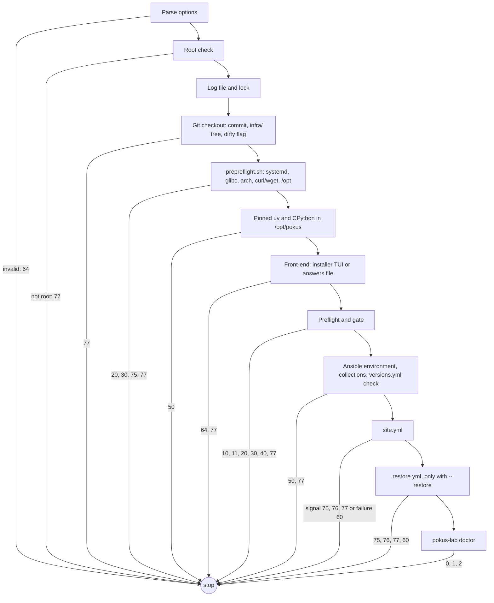

# How bootstrap works

`bootstrap/bootstrap.sh` is the single entry point that turns a machine into a
Pokus lab host. It runs a fixed sequence of stages, stops with a documented
exit code whenever an operator has to act, and records what it applied. Every
stage is idempotent, so the answer to any stop is: deal with the cause, then
run the same command again. The options are listed in the
[bootstrap.sh reference](../reference/cli/bootstrap.md); what to do about each
exit code is in [How to troubleshoot a bootstrap run](../how-to/troubleshoot.md).

## The stages



1. **Options and root.** Invalid options end with 64 before anything else
   happens. Bootstrap changes the host, so it must run as root (77 with a
   `sudo` hint otherwise).
2. **Log and lock.** All output is copied to
   `/var/log/pokus-bootstrap/<UTC timestamp>.log` (mode 0600, root only). A
   lock in `/run/lock` makes a second, concurrent run stop with 77.
3. **Git checkout.** Bootstrap runs from a clone of the repository. It records
   the commit, the tree hash of `infra/` and whether `infra/` has uncommitted
   changes; a dirty `infra/` stops the run unless `--allow-dirty` is given,
   which is recorded. Changes outside `infra/` do not count, because the
   platform and the catalog are deployed from tags, not from the working
   tree. Git runs as root in a checkout that usually belongs to the admin who
   called `sudo`. The checkout must be owned by root or by that admin, so a
   checkout prepared by another account cannot run code as root through its
   git configuration; the fsmonitor hook is disabled in addition. `--ref`
   must name the checked-out commit.
4. **Pre-preflight.** `bootstrap/lib/prepreflight.sh` is plain POSIX `sh`
   and checks only what is needed before anything is installed: root, systemd
   as PID 1, glibc, `x86_64` or `aarch64`, `curl` or `wget` and `tar`, and a
   writable `/opt`. A missing tool ends with 30 and the exact install command
   for the host's package manager. On WSL without systemd it can add
   `[boot] systemd=true` to `/etc/wsl.conf` after asking, and then ends with
   75 because the distribution must restart.
5. **Pinned tooling.** Bootstrap downloads the uv release pinned in
   `versions.lock.yml`, checks its sha256, and installs it to
   `/opt/pokus/bin/uv`. uv then installs the pinned CPython into
   `/opt/pokus/python`. Everything after this point uses that interpreter,
   never the distribution's Python.
6. **Front-end.** The installer environment `/opt/pokus/installer-venv` is
   synchronized from the hash-locked `installer/requirements.lock`. On a
   terminal of at least 80x24, bootstrap releases its lock and hands the
   terminal to the installer TUI, which collects the settings, writes the
   files after its Review screen and runs bootstrap again with
   `--non-interactive --no-tui` for the installation itself, following its
   event stream. With `--answers`, bootstrap instead replays the answers file:
   it checks it, writes the same files with the vault password of
   `--vault-password-file`, and continues with the machine of the file (see
   [How to install a lab from an answers file](../how-to/install-without-the-tui.md)).
   With neither, `--machine` names an existing `host_vars` file.
7. **Preflight and gate.** Preflight writes the new host profile to
   `/run/pokus/bootstrap/host-profile.json`. The gate applies the outcome, as
   described below. The profile is then compared with the stored
   `/etc/pokus/host-profile.json`, and if consistent it replaces it.
8. **Ansible environment.** The hash-locked `bootstrap/requirements.lock` is
   synchronized into `/opt/pokus/ansible-venv`, the pinned collections are
   installed into `/opt/pokus/ansible-collections`, and
   `ansible/group_vars/all/versions.yml` must carry the sha256 of
   `versions.lock.yml` (77 if it is out of date).
9. **The play.** `ansible-playbook` runs `site.yml` with `-e machine=<name>`
   and the host profile and bootstrap options as variables, followed by
   `restore.yml` with `--restore`.
10. **Doctor.** `pokus-lab doctor` checks the result; its exit code (0, 1 or
    2) becomes the exit code of bootstrap. In check mode (`--check`) the
    doctor is skipped.

## The preflight gate

Preflight decides one of five outcomes (see
[How the preflight gate decides](preflight-gate.md)); bootstrap acts on them:

| Preflight result | Bootstrap |
| --- | --- |
| `supported` | continues |
| `degraded` | lists every disabled feature and its research impact; continues with `--accept-degraded` or a `y` at the prompt, otherwise stops with 10 |
| `unsupported` | stops with 20; `--force-unsupported` continues unless an operator action is also required |
| `needs_action` | prints the remediation and stops with 30 |
| `preflight_error` | stops with 40; the traceback is in the log |
| tier `experimental` | continues with `--accept-experimental` or a `y` at the prompt, otherwise stops with 11 |

Consent given at a prompt is written into the host profile like the
corresponding option, so the profile and every environment fingerprint show
it.

A host whose capabilities change silently must not be provisioned as if
nothing happened. If outcome, provider or a feature flag differs from the
stored profile, bootstrap prints the differences and stops with 77; after
review, `--refresh-profile` accepts them. One case is accepted without the
option: when the previous run ended with a signal from the play (a WSL
restart, a reboot or another operator action that the play asked for),
because the change is the expected result of that action.

## Signals from the play

Some conditions can only be detected inside Ansible: a changed `wsl.conf`
needs a WSL restart, a new driver needs a reboot, a Secure Boot key must be
enrolled. A role then writes `/run/pokus/bootstrap-signal.json`:

```json
{"code": 76, "message": "Reboot required: enroll the MOK at the blue MOK Manager screen, then re-run bootstrap."}
```

and fails the play. Bootstrap removes any old signal file before each play,
and when the play fails it reads the file: codes 75, 76 and 77 become the exit
code and the message is printed and recorded. A play that fails without a
valid signal ends with 60.

A 76 can also name a Machine Owner Key (`"mok_key"`): the driver's signing
key on a Secure Boot host, neither enrolled nor waiting for enrollment.
Bootstrap then imports it with `mokutil --import`, giving it the operator's
one-time password on standard input, before it exits; without the password,
or if `mokutil` fails, it ends with 77 and says how to import the key by hand.
Bootstrap has the password only when the operator consented to the MOK
enrollment; [Bare-metal hosts](../providers/baremetal.md#secure-boot-and-reboots)
describes the whole flow.

The play runs on the host it provisions, so it never reboots the host itself.
After signal 76, bootstrap schedules a reboot one minute later only if it was
started with `--allow-reboot` and not in check mode; the state file is written
before the reboot happens, and the next run continues where this one stopped.

## What bootstrap records

| Record | Where | Content |
| --- | --- | --- |
| Log | `/var/log/pokus-bootstrap/<UTC>.log` (0600) | everything bootstrap and Ansible printed |
| Host profile | `/etc/pokus/host-profile.json` (0644), archived in `/var/lib/pokus/preflight/` | the last accepted preflight result, with overrides |
| State | `/etc/pokus/bootstrap-state.json` (0644) | repository commit, `infra/` tree hash and dirty flag, ref, start and end time, tags, overrides, last stage, result, exit code, signal, log file |
| Events | the file named by `POKUS_EVENTS_FILE`, if set | one JSON line per stage start and end, signal and final result, for the installer TUI |

The state is written at every exit once the checkout is known, also after a
failure, so `result` (`success`, `doctor_warnings`, `doctor_failures`,
`signal` or `failed`) tells whether the recorded commit was fully applied.
Check mode (`--check`) writes neither the state nor the host profile.

## Errors inside bootstrap

Every stage either returns or stops with one of the documented codes. A
command that fails unexpectedly is caught by an error trap that prints the
command and its location and ends with 70, so an unknown failure is never
reported as one of the documented conditions.
