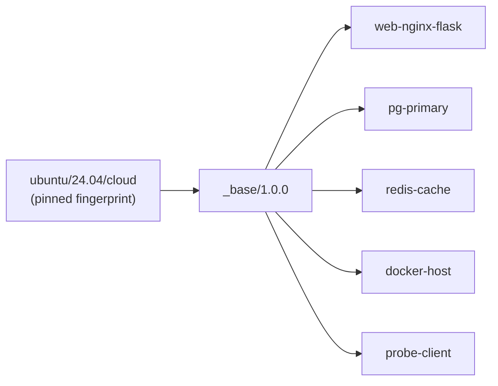
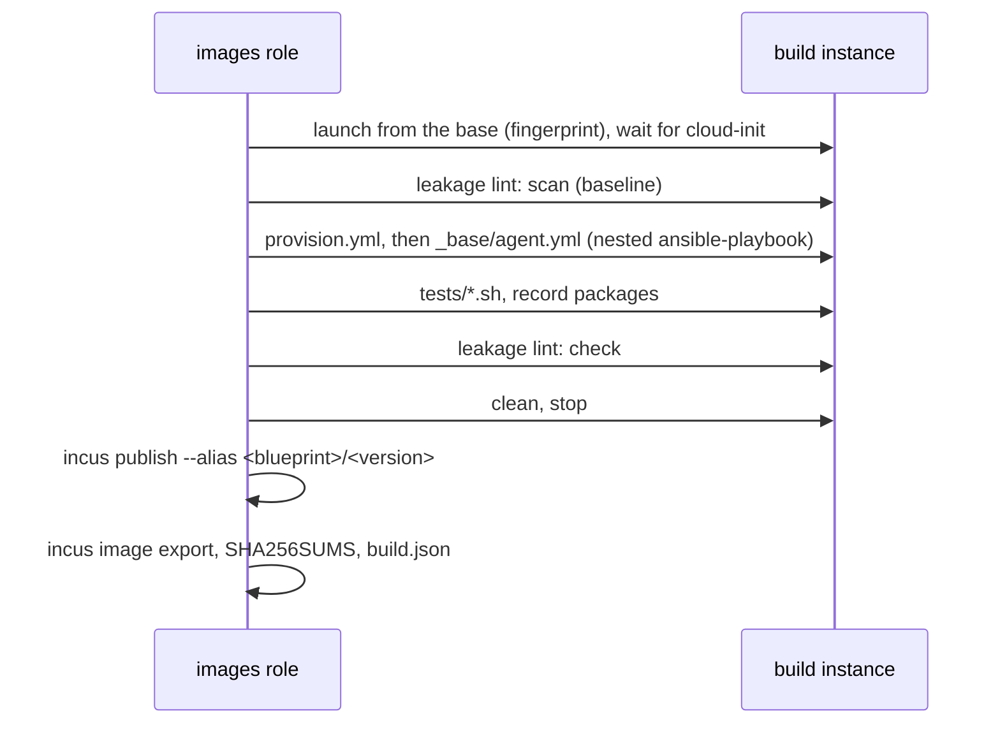

# How golden images are built

Every benchmark target starts from a *golden image*: an Incus image that the
`images` role built from a recipe in the repository, tested, checked for
leaks, and published under a versioned alias. Targets therefore have the same
userland on every lab host, whatever distribution the host runs. This page
explains how a recipe becomes an image and what the pipeline guarantees.

## Blueprints

A blueprint is a directory `images/<blueprint>/`:

| File | Content |
| --- | --- |
| `image.yaml` | name, version, base (a pinned upstream image or another blueprint), type (`container` or `vm`), `nesting`, packages, container images to preload by digest, services, the agent's `telemetry` settings, tests |
| `cloud-init.yaml` | user data of the build instance (kept minimal) |
| `provision.yml` | the playbook that turns the base into the blueprint |
| `files/` | files and templates the playbook installs |
| `tests/` | shell scripts that assert the result inside the instance |

The schema is `tools/lockcheck/schema/image-blueprint.schema.json`;
`make lint-schemas` checks every blueprint against it.

`_base` adds the OpenTelemetry agent (the pinned `otelcol-contrib` package),
common administration tools, a persistent journal, UTC, and disables
automatic package updates so that an image never changes after its build.
The other blueprints start from `_base`.

Distribution packages are not pinned to versions: Ubuntu's archive keeps only
the current version of each package, so a pin would break every rebuild. The
versions a build installed are recorded in the export's `packages.txt`, and
the pinned base fingerprint fixes everything the build did not change.

## The build flow

The role builds a blueprint only when neither its alias `<blueprint>/<version>`
nor its export exist. The build runs in the Incus project `build`, the only
project whose network (`pokus-build0`) has NAT to the internet:

The published image carries the properties of the
[integration contract](../contracts.md#incus): `pokus.recipe_commit` (the
repository commit, with `-dirty` when the infra tree had changes),
`pokus.built_at` and `pokus.base_fingerprint`; `requirements.nesting` makes
Incus refuse to start a blueprint that needs nesting without it. A failed
build keeps its instance `build-<blueprint>` for inspection; the next run
replaces it.

## Telemetry inside the image

The agent reads the whole journal and, per blueprint, extra log files that
do not go to the journal (`telemetry.log_files`, for example nginx's access
log), and collects host metrics. It sends OTLP to `127.0.0.1:4317` inside a
container, which the platform connects to the lab's collector with a proxy
device, and to the collector's VM listener inside a VM
([telemetry](telemetry.md)). The image contains no identity of a run: at
launch the platform sets `OTEL_RESOURCE_ATTRIBUTES` (`pokus.run_id`,
`pokus.node`), and a small helper hands the value of the instance's init
process to the agent before it starts.

## The leakage lint

An agent that reads `/etc` must not learn which fault it is facing. The lint
fails the build when the build added a scenario-like identifier
(`[A-Z]+-[0-9]{3}`), or the strings `fault`, `inject`, `ground_truth` or
`scenario`, to a file name or file contents below `/etc`, `/opt`, `/srv` or
`/usr/local`, to a unit name or the host name, or when any `.git` directory
exists. Findings the base already had do not count, and a short list of
benign words (`default` contains `fault`) is cut out of each finding before
the patterns are applied again;
[ADR-0012](../adr/0012-leakage-lint.md) explains why. The patterns, the
directories and the benign words are role variables.

## Cleaning

Before the instance is stopped and published, the clean step removes the
package caches and lists, shell histories, logs and the journal, cloud-init's
state (so it runs again on the first boot of every target), empties
`/etc/machine-id`, deletes the SSH host keys and the host name (cloud-init
creates new ones on first boot) and removes the build's own files, among them
the lint.

## Exports

Each image is exported to `/srv/pokus/images/<blueprint>/<version>/` with
`SHA256SUMS`, `packages.txt` and `build.json` (fingerprint, base, properties,
files). Public image servers rotate their images and delete old ones, so the
pinned upstream base is exported too, to
`/srv/pokus/images/_upstream/<base>/<fingerprint>/`: a lab can rebuild a
blueprint years later from the same base. When an alias is missing but its
export exists (for example on a restored host), the role checks the export's
fingerprint and imports it instead of building a different image.

Related: [How to build and export golden images](../how-to/build-golden-images.md),
[How benchmark targets are isolated](target-isolation.md).
