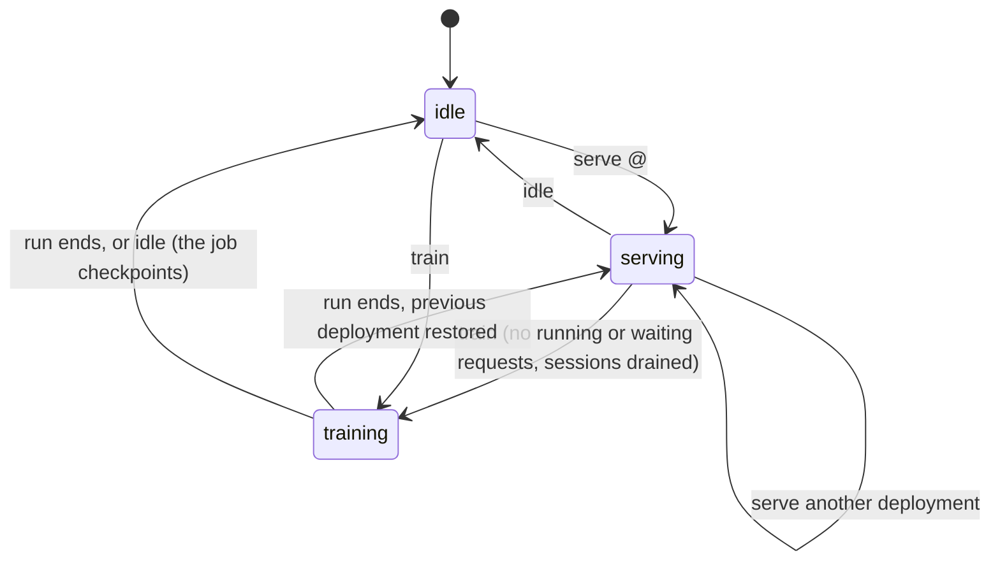

# The GPU arbiter

A lab has one GPU, and two things want it: vLLM, which serves the agents'
model, and the platform's training jobs, which turn benchmark data into
adapters. Both must never hold the GPU at the same time, a training run must
never see data it must not learn from, and every adapter the lab serves must
be traceable to the data, code and settings that produced it. One root-owned
program, the GPU arbiter (`pinka-gpu-arbiter`, BUILD_PROMPT §7.18), takes
care of all three. It replaces contract v1's deploy helper.

## Three modes, one at a time

The arbiter is always in exactly one mode: `idle`, `serving <deployment>` or
`training <run>`. `/var/lib/pinka/gpu/state.json` holds the mode, and every
change is appended to `/var/lib/pinka/gpu/transitions.jsonl` (time, from,
to, who asked, the deployment or run, the outcome) and written to the
journal. `pinka status` shows the mode and the last transitions.

vLLM (`pinka-inference.service`) starts only through the arbiter: the unit
is installed but not enabled, and the arbiter starts it when it serves a
deployment and stops it before a training run. Deployment specs stay as in
contract v1 (`/etc/pinka/vllm/deployments/<id>@<version>.yml`); the arbiter
renders `current.yaml` and `current.env` from them and waits until vLLM
answers `/health` before it reports `serving`. A deployment that does not
come up leaves the GPU idle.

## Who may ask

The arbiter listens on `/run/pinka/gpu.sock` (0600). The socket belongs to
the active platform's controller, the only platform service that may change
the GPU's mode; on an inference node it belongs to the control endpoint,
which may only ask for `status` and `serve` (its `POST /activate`). Root
uses the same socket through `pinka gpu`. Each connection starts one
arbiter process (`pinka-gpu-arbiter@.service`), which checks the caller's
UID with `SO_PEERCRED` before it reads the request. The requests and their
answers are in [GPU arbiter requests](../reference/gpu-arbiter.md).

## Training runs

A platform declares its training jobs in the manifest (`jobs[]`, profile
`gpu-trainer`); their images are pulled by digest when the platform is
deployed, never when a job starts. The controller submits a run: the job,
the base model, the datasets by hash, hyperparameters and a seed. Before it
switches anything the arbiter checks that this host trains at all (only a
`full` node does), that the base model's files match their hashes, that
every dataset matches its hash and contains no instance of the `test`
split, that the job stays within `training_caps`, and, while it serves,
that vLLM has no running or waiting request and the controller has declared
its sessions drained. The job-spec hash is the SHA-256 of the canonical
JSON of the submission; it names the run and goes into the adapter's
lineage.

The run executes as `pinka-gpu-job@<run>.service`, which runs the container
`pinka-job-<run>` with options infra fixes and the manifest cannot change:
no network, a read-only root file system with a private `/tmp`, no
capabilities, no new privileges, Docker's default seccomp profile, no host
namespace, the job's own account with `pinka-datasets` as its only extra
group, the manifest's memory and CPU limits and infra's process limit. It
sees exactly three kinds of mounts: the base model and the datasets
read-only, and the run's `output/` and `checkpoints/` directories
read-write. The GPU comes in through CDI (or the NVIDIA runtime) only when
the job asks for it; `resources.gpus: 0` is the CPU-only variant.

When the container exits, the arbiter settles the run. On success it hashes
`output/adapter/` and registers it read-only under
`/srv/pinka/models/adapters/<name>/<sha256>/` with `MANIFEST.json` and
`LINEAGE.json` (base model hashes, dataset hashes, image digest, job-spec
hash, hyperparameters, seed, the platform's and infra's commits, start and
end). A timeout, a non-zero exit or a missing adapter ends the run as
failed. Afterwards the arbiter serves the deployment that was served before
the run, unless the submission asked otherwise
(`gpu_arbiter.restore_after_training` is the default).

`idle` during a run stops the container with `stop_grace` seconds to write
its checkpoint; the run ends `interrupted` if its job is `resumable`,
`failed` otherwise. Stopping the lab does the same: `pinka stop` and
`pinka update-host` ask the arbiter for `idle` after the platform's drain
hook.

## Boot

`pinka-gpu-arbiter.service` runs once when the lab starts. After a reboot,
a run that was training is interrupted; it resumes from its checkpoint
directory if its job is `resumable`, otherwise the previous deployment comes
back or the GPU stays idle. Without such a run the arbiter serves the
default deployment or stays idle, per `gpu_arbiter.after_boot`. When the lab
starts again within the same boot (`pinka start` after `pinka stop`), an
idle GPU follows the same setting and a serving deployment that stopped is
brought back.

## Datasets and the split guard

The platform builds a training dataset in its controller's own state and
asks the arbiter to publish it. The arbiter copies the files (only regular
files and directories that belong to the controller, through directory
handles, so no link swapped in during the copy can make root read anything
else), hashes the copy and stores it under
`/srv/pinka/training/datasets/<sha256>/` (root:`pinka-datasets`, read-only)
with `PROVENANCE.json`: every scenario instance with its split, the source
runs and the platform's commit. A dataset that lists an instance of the
`test` split is refused at publication and again at mount, where its hash is
checked too. That the list is complete and truthful is the platform's
obligation; infra checks what it is given.

## Who reaches the inference API

vLLM listens on `127.0.0.1:18704`, and on a lab node the inference forwarder
offers the paired node's API on the same address. Only root, infra's
scrapers, and the platform's controller and inference broker reach that
port: the inference guard (`inet pinka_inference_guard`, firewall role)
resets every other account's connection, and only root and the controller
reach the forwarder's control port. The guard resolves the platform's
accounts when it loads and is reloaded after every deployment.
[ADR-0016](../adr/0016-telemetry-query-isolation.md) records why a UID
allowlist is used rather than vLLM's own options.

## Topology

Training runs only on a `full` node. A `lab` node has no arbiter; an
`inference` node's arbiter only serves. `pinka status` and doctor say that
training is unavailable on such hosts; training on a lab and inference pair
is future work.
