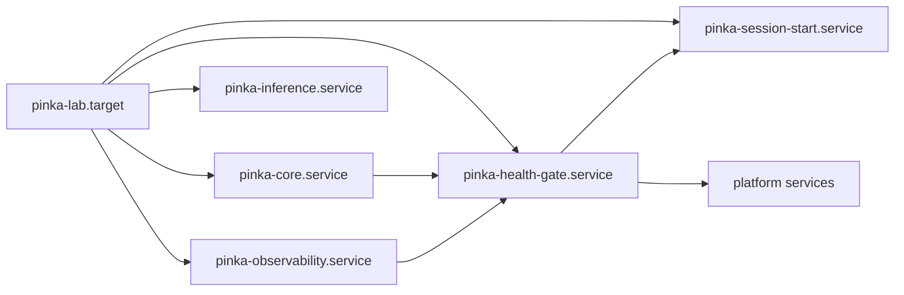

# How the lab comes up

A Pokus lab often runs on a personal machine that sleeps, reboots or is
switched off between campaigns. Experiments must still never start on a lab
that is only half up, and every run must be traceable to the exact state of
the machine it ran on. Three units of the `lab_session` role take care of
that; this page explains how they fit together.

## One target for the whole lab

`pinka-lab.target` is the lab. The Compose projects (PostgreSQL and OPA,
the observability stack, vLLM), the sleep inhibitor of
`power_policy: lab_session_inhibit` and the platform's services are all
wanted by it and stop with it. Starting the target is "the lab is up";
stopping it stops everything that belongs to the lab and nothing else. By
default the target starts at boot (`lab_session_autostart`).

## The health gate

`pinka-health-gate.service` runs after the lab's services started and
repeats a fixed set of checks until all pass or ten minutes are over
(`lab_session_gate_timeout`):

| Check | Passes when |
| --- | --- |
| time | the system clock is NTP-synchronized; on WSL also within one second of an NTP server, when one answers |
| postgres | the database container reports itself healthy |
| collector | the OpenTelemetry gateway answers its health check |
| incus | the Incus API answers |
| gpu | with `gpu_inference`: a container of the pinned CUDA image sees the GPU, the way vLLM gets it |

The platform's services require this unit, so an orchestrator never starts
runs on a lab whose clock jumped after a WSL resume, whose database is still
recovering, or whose telemetry would be lost. The result of the last round is
in `/run/pinka/health-gate.json`; a failed gate leaves the platform stopped
until an operator fixed the cause and started the target again.

WSL deserves the extra clock check: the WSL virtual machine's clock can fall
behind while Windows sleeps, and latency measurements compare timestamps
across the host and its targets.

## The session record

`pinka-session-start.service` writes one record per boot to
`/var/lib/pinka/sessions/<boot_id>.json`: the boot ID, the start time, the
environment fingerprint with its hash, and the outcome of a fresh read-only
preflight. The orchestrator imports the records, so every run can be tied to
the session, and therefore to the fingerprint, it ran in. A record is never
rewritten; when the fingerprint or preflight cannot be computed, the record
says why instead of being left out.

## Backups around an intermittent host

The backup timers are not part of the lab target: they run whether or not
the lab is up. Their timers are persistent, so a backup missed while the
machine was off runs shortly after the next boot. The nightly database dump
lands in `/srv/pinka/backups/pg/` before the restic backup that takes it to
the backup server; [How to back up the lab](../how-to/backup-and-restore.md)
covers configuring and restoring them.

Related: [How telemetry, metrics and logs flow through the lab](telemetry.md),
[Integration contract](../contracts.md).
