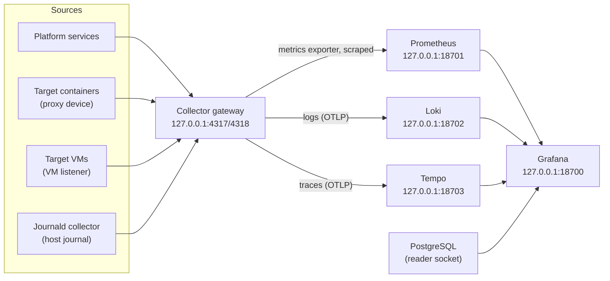

# How telemetry, metrics and logs flow through the lab

Everything the lab observes ends up in three stores: Prometheus for metrics,
Loki for logs and Tempo for traces. Grafana shows all three next to the
platform's database. This page explains the path each kind of data takes, how
a run's data stays findable, and the decisions behind the layout. The
`observability` role builds it; [ADR-0011](../adr/0011-otel-telemetry.md)
records why OpenTelemetry is the single entry point.

## One entry point: the collector gateway

The OpenTelemetry Collector gateway accepts OTLP over gRPC (`4317`) and HTTP
(`4318`) on `127.0.0.1`. Every pipeline runs `memory_limiter`, then
`resource` (which adds `pokus.machine` and `pokus.lab_mode` to every record),
then `batch`:

- **Logs** go to Loki's native OTLP endpoint (`/otlp`). Resource attributes
  that are not index labels become structured metadata, so a query filters
  them with `| pokus_run_id="<run_id>"`.
- **Traces** go to Tempo over OTLP gRPC.
- **Metrics** go to a Prometheus exporter on the gateway, which Prometheus
  scrapes (owner answer E14). Resource attributes become labels, so target
  metrics carry `pokus_run_id` and `pokus_node`.

## Where the data comes from

- **Platform services** send OTLP to `127.0.0.1:4317`.
- **Target containers** send OTLP to `127.0.0.1:4317` inside the container. An
  Incus proxy device the platform adds listens there and connects to the
  gateway on the host's loopback address; the container has no route to the
  host.
- **Target VMs** cannot use a proxy device (Incus supports them on VMs only in
  NAT mode). With the `vm_targets` feature, `pokus-vm-otlp-address.service`
  puts `198.18.0.1/32` (a benchmarking-range address, `pokus_vm_otlp`) on the
  dummy interface `pokus-otlp0` before Docker starts, and the gateway listens
  there too. The run ACL `pokus-run-default` lets run networks reach exactly
  that address on TCP `4317` and `4318`, and the firewall accepts nothing else
  from run networks (resolution C4).
- **The host journal** is read by a second collector instance, the journald
  collector. It runs the host's own `journalctl` (chroot into the read-only
  host root, which needs root and `CAP_SYS_CHROOT`) and forwards to the
  gateway. It is a separate instance on purpose: the gateway, which accepts
  data from targets an agent may have compromised, has no access to the
  host's files. The journal carries the Incus lifecycle events
  (`pokus-incus-events`), OPA's decision logs (container tag `pokus-opa`) and
  every unit's output; with semantic conventions on, `SYSLOG_IDENTIFIER`
  becomes `syslog_identifier`.
- **Prometheus** also scrapes node_exporter, cAdvisor, the PostgreSQL
  exporter, both collectors, Loki, Tempo, Grafana, Incus (with the
  metrics-only client certificate) and, with `gpu_inference`, the nvidia-smi
  GPU exporter and vLLM. Retention is `observability_prometheus_retention`
  (90 days by default).

## Finding a run's data

The platform starts every target with
`OTEL_RESOURCE_ATTRIBUTES=pokus.run_id=<run_id>,pokus.node=<node_alias>`
([integration contract](../contracts.md#telemetry)). The run ID is an opaque
ULID: it identifies the run, never the scenario. The dashboard
**Pokus: run explorer** takes a `run_id` and shows the run's database row,
its logs (Loki), its targets' CPU and memory (Prometheus) and its traces
(Tempo, TraceQL `{ resource.pokus.run_id = "<run_id>" }`); a `trace_id`
variable opens one trace.

| Attribute | Set by | Where it shows up |
| --- | --- | --- |
| `pokus.run_id` | platform, per target | Loki structured metadata `pokus_run_id`; Prometheus label `pokus_run_id`; Tempo resource attribute |
| `pokus.node` | platform, per target | `pokus_node` |
| `pokus.machine` | collector gateway | `pokus_machine` |
| `pokus.lab_mode` | collector gateway | `pokus_lab_mode` |
| `pokus.deployment`, `pokus.model_id` | vLLM's environment | traces of vLLM |

## Why every service uses the host network on 127.0.0.1

The observability containers use the host network and bind `127.0.0.1` only;
none publishes a port. Prometheus must scrape the Incus API, which listens on
`127.0.0.1:8443`, and node_exporter must see the host's own network
interfaces; neither is reachable from a container on a Docker bridge network.
On the host network, every listener is a deliberate one: Loki and Tempo keep
their rings in memory, so they open no cluster ports, and the configuration
tests check that every listen address is `127.0.0.1` (or the VM listener
address). The configurations were run once with the pinned releases while
they were written, and every process listened only on `127.0.0.1`.

PostgreSQL is the exception the other way round: its container has no
network at all. Grafana reads it through the reader socket directory as
`pokus_grafana`, the exporter through the service socket directory as
`pokus_monitor` ([ADR-0010](../adr/0010-postgres-socket-only.md)).

Related: [How benchmark targets are isolated](target-isolation.md),
[Lab host architecture](../architecture.md),
[How to reach Grafana](../how-to/reach-grafana.md).
