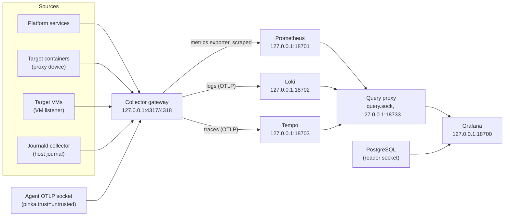

# How telemetry, metrics and logs flow through the lab

Everything the lab observes ends up in three stores: Prometheus for metrics,
Loki for logs and Tempo for traces. Grafana shows all three next to the
platform's database. This page explains the path each kind of data takes, how
a run's data stays findable, and the decisions behind the layout. The
`observability` role builds it; [ADR-0011](../adr/0011-otel-telemetry.md)
records why OpenTelemetry is the single entry point.

## One entry point: the collector gateway

The OpenTelemetry Collector gateway accepts OTLP over gRPC (`4317`) and HTTP
(`4318`) on `127.0.0.1`. Every pipeline runs `memory_limiter`, then
`resource` (which adds `pinka.machine` and `pinka.lab_mode` to every record),
then `batch`:

- **Logs** go to Loki's native OTLP endpoint (`/otlp`). Resource attributes
  that are not index labels become structured metadata, so a query filters
  them with `| potka_run_id="<run_id>"`.
- **Traces** go to Tempo over OTLP gRPC.
- **Metrics** go to a Prometheus exporter on the gateway, which Prometheus
  scrapes (owner answer E14). Resource attributes become labels, so target
  metrics carry `potka_run_id` and `potka_node`.

## Who may send and who may query

Sending and querying are separate ways in (BUILD_PROMPT §7.9,
[ADR-0016](../adr/0016-telemetry-query-isolation.md)):

- Platform services send OTLP to the collector. The `untrusted-agent`, which
  has no network, sends OTLP/HTTP to `/run/pinka/otlp/agent.sock`; systemd's
  socket proxy forwards it to the collector's receiver `otlp/agent`, whose
  pipelines set `pinka.trust=untrusted` on everything, whatever the agent
  claimed. Loki indexes `pinka.trust` and the platform's `telemetry.labels`
  as labels.
- Telemetry is queried only through the query proxy, an nginx container. It
  forwards only the query endpoints of Prometheus, Loki and Tempo (instant
  and range queries, series, labels and label values, trace lookup and
  search) and answers 403 to everything else: push and remote write,
  deletion, admin, configuration, flush, rules and alerting. Platform
  services that query (their profiles put them in `pinka-query`) use
  `/run/pinka/query.sock`; Grafana's data sources use its loopback port.
- Only infra's own clients reach the stores directly: root (doctor, the
  health gate), the collector, Prometheus, Loki, Tempo, Grafana and the query
  proxy, each running as an infra account of its own
  (`pinka_telemetry_clients`). The telemetry guard, an nftables table of its
  own on every firewall backend, resets every other account's connection to
  the stores' ports, the collector's metrics exporter and the proxy's
  loopback port on the host loopback: researchers query through Grafana,
  the platform's services through the socket and its group. Doctor checks
  that the guard admits exactly these accounts, the query socket's link and
  directory, and both sockets (`telemetry.isolation`).

## Where the data comes from

- **Platform services** send OTLP to `127.0.0.1:4317`.
- **Target containers** send OTLP to `127.0.0.1:4317` inside the container. An
  Incus proxy device the platform adds listens there and connects to the
  gateway on the host's loopback address; the container has no route to the
  host.
- **Target VMs** cannot use a proxy device (Incus supports them on VMs only in
  NAT mode). With the `vm_targets` feature, `pinka-vm-otlp-address.service`
  puts `198.18.0.1/32` (a benchmarking-range address, `pinka_vm_otlp`) on the
  dummy interface `pinka-otlp0` before Docker starts, and the gateway listens
  there too. The run ACL `pinka-run-default` lets run networks reach exactly
  that address on TCP `4317` and `4318`, and the firewall accepts nothing else
  from run networks (resolution C4).
- **The host journal** is read by a second collector instance, the journald
  collector. It runs the host's own `journalctl` (chroot into the read-only
  host root, which needs root and `CAP_SYS_CHROOT`) and forwards to the
  gateway. It is a separate instance on purpose: the gateway, which accepts
  data from targets an agent may have compromised, has no access to the
  host's files. The journal carries the Incus lifecycle events
  (`pinka-incus-events`), OPA's decision logs (container tag `pinka-opa`) and
  every unit's output; with semantic conventions on, `SYSLOG_IDENTIFIER`
  becomes `syslog_identifier`.
- **Prometheus** also scrapes node_exporter, cAdvisor, the PostgreSQL
  exporter, both collectors, Loki, Tempo, Grafana, Incus (with the
  metrics-only client certificate) and, with `gpu_inference`, the nvidia-smi
  GPU exporter and vLLM. Retention is `observability_prometheus_retention`
  (90 days by default).

## Finding a run's data

The platform starts every target with
`OTEL_RESOURCE_ATTRIBUTES=potka.run_id=<run_id>,potka.node=<node_alias>`
([integration contract](../contracts.md#telemetry)). The run ID is an opaque
ULID: it identifies the run, never the scenario. The dashboard
**potka: run explorer** takes a `run_id` and shows the run's database row,
its logs (Loki), its targets' CPU and memory (Prometheus) and its traces
(Tempo, TraceQL `{ resource.potka.run_id = "<run_id>" }`); a `trace_id`
variable opens one trace.

| Attribute | Set by | Where it shows up |
| --- | --- | --- |
| `potka.run_id` | platform, per target | Loki structured metadata `potka_run_id`; Prometheus label `potka_run_id`; Tempo resource attribute |
| `potka.node` | platform, per target | `potka_node` |
| `pinka.machine` | collector gateway | `pinka_machine` |
| `pinka.lab_mode` | collector gateway | `pinka_lab_mode` |
| `pinka.deployment`, `pinka.model_id` | vLLM's environment | traces of vLLM |

## Split inference: an inference node forwards everything

An inference node (`node_role: inference`, see [node roles](../node-roles.md))
runs the collectors, node_exporter, cAdvisor and the GPU exporter, but no
Prometheus, Loki, Tempo or Grafana (their Compose profile `stores` is off).
Its collector gateway scrapes the local exporters and vLLM itself and sends
every log record, metric and span to the paired lab node with OTLP over gRPC
and mutual TLS (port 4317 of the lab node's tailnet address). Until the node
is paired, nothing leaves it. On the lab node a separate receiver accepts
only the paired node's certificate and sets `pinka.machine` to that node's
name, so its data shows up with `pinka_machine="<inference-node>"` next to
the lab node's own. The collector's container user (`pinka-otelcol`) reads a
private copy of the pairing material in
`/etc/pinka/secrets/containers/otel-pairing`.

## Why every service uses the host network on 127.0.0.1

The observability containers use the host network and bind `127.0.0.1` only;
none publishes a port. Prometheus must scrape the Incus API, which listens on
`127.0.0.1:8443`, and node_exporter must see the host's own network
interfaces; neither is reachable from a container on a Docker bridge network.
On the host network, every listener is a deliberate one: Loki and Tempo keep
their rings in memory, so they open no cluster ports, and the configuration
tests check that every listen address is `127.0.0.1` (or the VM listener
address, or on a paired lab node the tailnet address of the split-inference
receiver). The configurations were run once with the pinned releases while
they were written, and every process listened only on `127.0.0.1`.

PostgreSQL is the exception the other way round: its container has no
network at all. Grafana reads it through the reader socket directory as
`potka_grafana`, the exporter through the service socket directory as
`pinka_monitor` ([ADR-0010](../adr/0010-postgres-socket-only.md)).

Related: [How benchmark targets are isolated](target-isolation.md),
[Lab host architecture](../architecture.md),
[How to reach Grafana](../how-to/reach-grafana.md).
