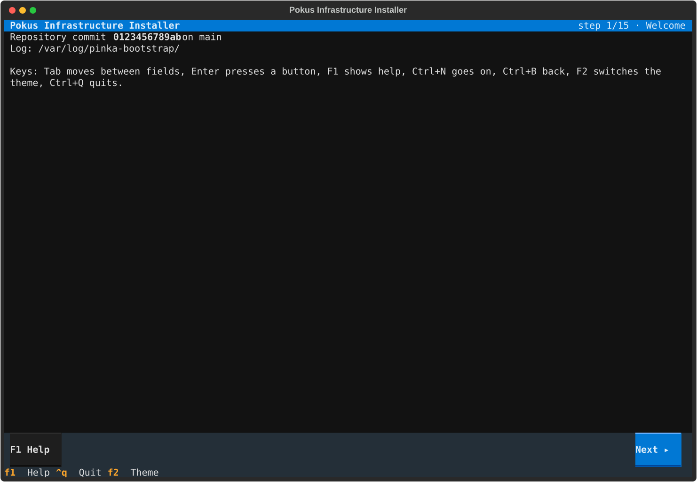
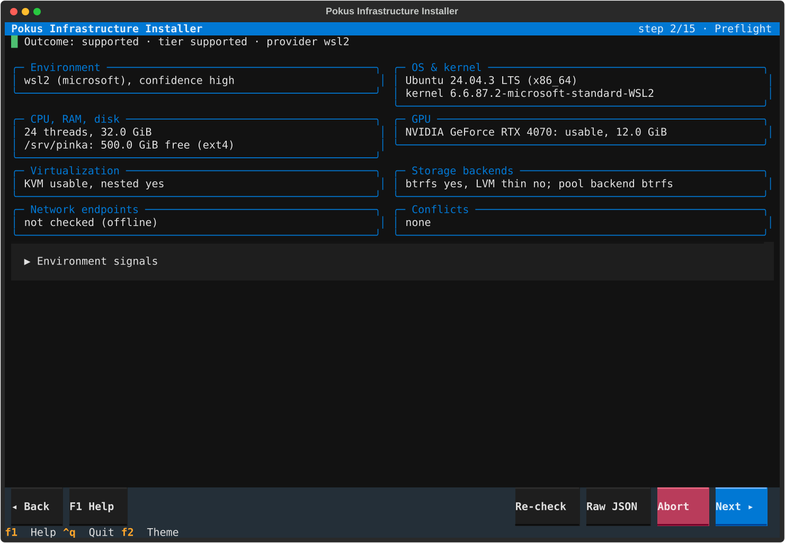
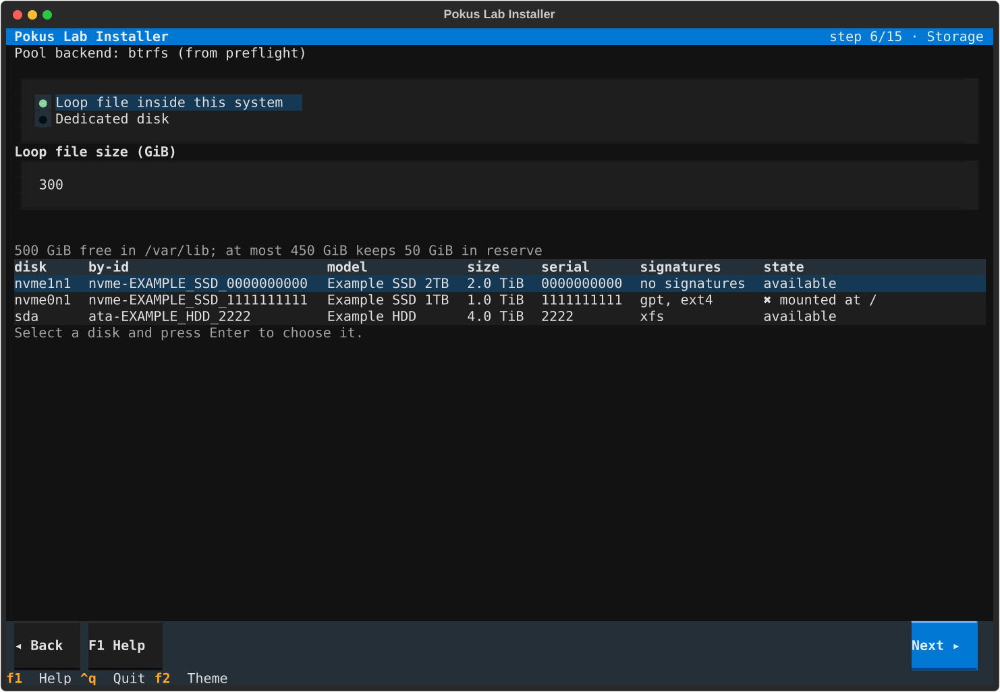
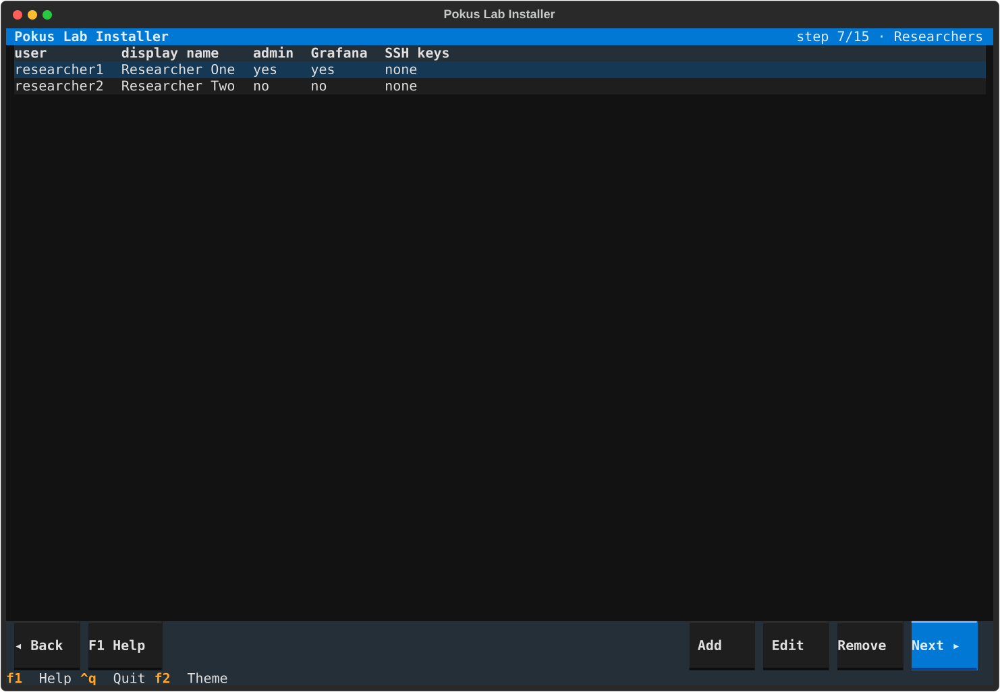
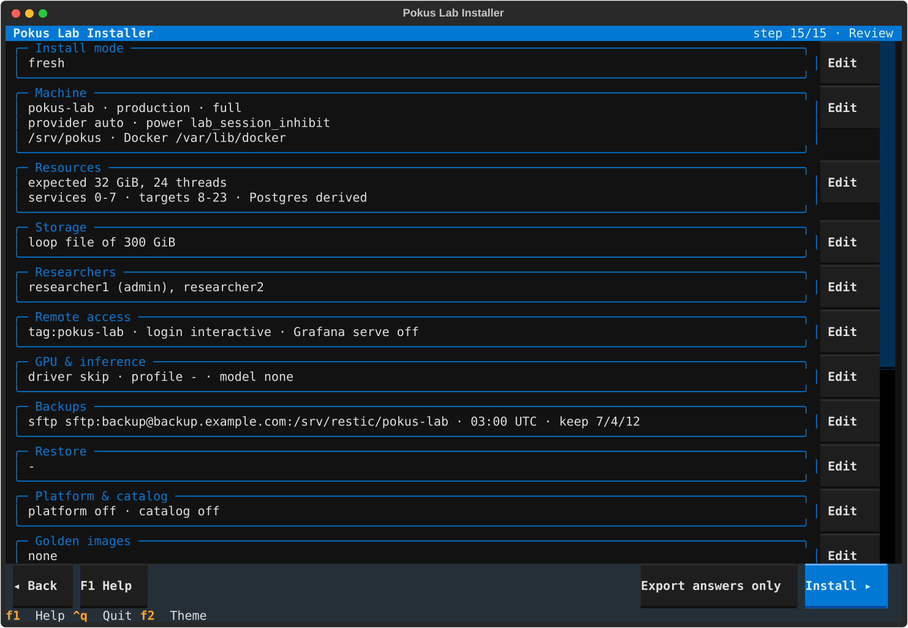
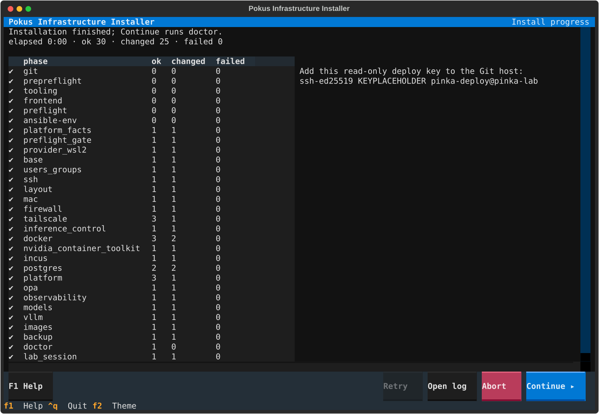
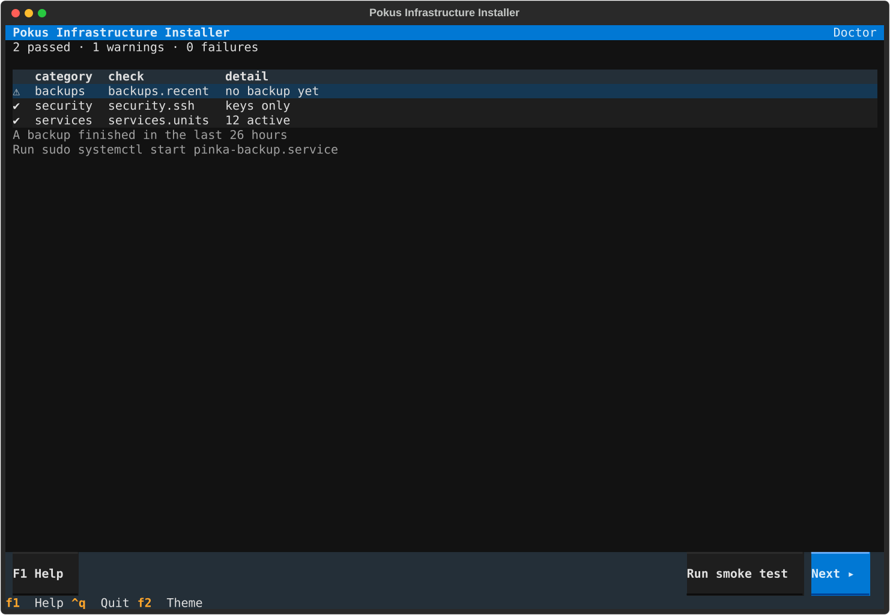

# How to install a lab with the installer TUI

The installer TUI asks for every setting of the lab host, shows all of them
for review, writes the configuration files and then runs bootstrap
non-interactively while it shows the progress. Nothing changes on the host
before you press **Install** on the Review screen.

!!! note "Prerequisites"
    - A host that preflight accepts (see
      [How to check whether a machine can host the lab](check-a-host.md)).
    - A clone of the pokus-infrastructure repository owned by your own user, with a clean
      `infra/` directory.
    - `sudo` rights on the host.
    - A terminal of at least 80 columns and 24 lines, with `TERM` set (any
      SSH session or WSL terminal works). Without one, use
      [an answers file](install-without-the-tui.md).
    - A Tailscale account: either a pre-approved auth key tagged
      `tag:pinka-lab`, or a browser to log in during the install.
    - The researchers' SSH public keys.
    - A vault password of at least 12 characters, which you keep safe: every
      later bootstrap needs it.

## Start the installer

1. Go to the infra component of your checkout and start bootstrap:

    <!-- qa:skip reason="interactive; provisions the host" -->
    ```bash
    cd <checkout>/infra
    sudo ./bootstrap/bootstrap.sh
    ```

    `<checkout>` is the directory of your clone. Bootstrap checks the
    checkout, installs its pinned tools and then hands the terminal to the
    installer. Options you add here (for example `--allow-reboot` or
    `--skip-tags=images`) are passed on to the installation.

    

2. Press ++ctrl+n++ (or **Next**) to run preflight. The cards show what it
   found; a degraded host lists each missing feature with its consequence,
   and you tick each one to accept it. An unsupported host can only be forced
   by typing `FORCE UNSUPPORTED`, which every fingerprint then records. With
   Secure Boot on and no NVIDIA driver, the screen explains the Machine Owner
   Key (MOK) enrollment: tick *Install the driver and enroll a MOK at the
   next boot* to consent (recorded), or press *Continue without the driver*.
   Preflight runs again with your choice.

    

## Answer the screens

Each screen checks its fields when you go on and shows a message next to a
wrong field. ++f1++ shows the screen's help. Screens that do not apply to
the host (the GPU screen without a GPU, Restore outside restore mode) are
shown greyed out with the reason.

| Keys | Action |
| --- | --- |
| ++tab++, ++shift+tab++ | Next or previous field |
| ++enter++ | Press the focused button, choose the selected table row |
| ++ctrl+n++, ++ctrl+b++ | Next or previous screen (going back keeps your entries) |
| ++f1++ | Help for the screen |
| ++f2++ | Switch between the dark, light and high-contrast themes |
| ++ctrl+q++ | Quit; your choices so far are kept for the next start |

1. **Install mode**: *Fresh install*, *Restore from backup*, or *Modify the
   existing installation* (offered once a lab is installed here).
2. **Machine**: the machine name names `host_vars/<machine>.yml` and the
   tailnet host. A *lab* node and an *inference* node are paired after both
   are installed (see
   [How to run inference on a separate GPU node](pair-inference-node.md)).
3. **Resources**: the CPU split between lab services and targets. The
   suggestion keeps both threads of a core in one set; a yellow warning
   shows when your split separates them. On WSL, enter the memory and
   processors you set in `.wslconfig`.
4. **Storage**: a loop file, or a dedicated disk. Choosing a disk opens a red
   dialog in which you type its full `/dev/disk/by-id/` path; a disk with
   existing signatures also needs `WIPE`.

    !!! danger "Data loss"
        The disk you confirm is formatted as the Incus storage pool when the
        installation runs. Mounted and system disks cannot be chosen.

    

5. **Researchers**: add each researcher with **Add**, paste their public keys
   (private keys are refused), and make at least one an admin. Removing a
   researcher from an installed lab locks the account; the data stays.

    

6. **Remote access**: the Tailscale tag and login. **Copy ACL** copies the
   lines your tailnet policy needs.
7. **GPU & inference**: the driver (never on WSL), the serving profile and the
   default model. A model must be pinned in `models.lock.yml`: select it and
   press **Pin model** (this needs the Hugging Face Hub). With Secure Boot
   and no driver, `auto` needs the consent from the Preflight screen and a
   one-time MOK password, entered twice: the installation imports the key
   with it, and you type it again in MOK Manager after the reboot. It is
   never stored. `manual` is refused there until the driver is installed.
8. **Data & backups**: the restic repository and schedule. A generated restic
   password is shown once: store it outside the host and tick
   *I stored this safely*.
9. **Restore** (restore mode only): pick the snapshot.
10. **Platform & catalog**: the versions to deploy and the repository. For an
    SSH URL, **Deploy key** creates the read-only key to add to the Git host,
    and **Test access** checks it.
11. **Golden images**: which images to build, now or later.
12. **Secrets & vault**: every service password is generated. Enter the vault
    password twice, or the path of a file that contains it.

## Review and install

1. The Review screen shows every setting with an **Edit** button, every file
   that will be written with its differences, and in red what cannot be
   undone. **Export answers only** writes `installer-answers/<machine>.yml`
   and nothing else, for a later
   [installation without the TUI](install-without-the-tui.md).

    

2. Press **Install**. The installer writes the files (owned by your user,
   the vault encrypted) and runs bootstrap. The tree shows each stage and
   Ansible role; the Tailscale login URL and its QR code appear when the
   login waits for you, and a new deploy key when one was created.

    

    - On a failure, the failed task and its error are shown with the exit
      code; fix the cause ([Troubleshoot a bootstrap run](troubleshoot.md))
      and press **Retry**.
    - If WSL must restart (75) or the host must reboot (76), the installer
      shows what to do and quits. Run `sudo ./bootstrap/bootstrap.sh` again
      afterwards and choose *Resume*: the installer asks for the vault
      password again (it never stores it, unless you chose to keep it in
      `/etc/pinka/secrets/vault-pass`) and continues the installation.

3. **Continue** runs doctor. Warnings are normal on a new lab (no backup
   yet); failures come with what to do. **Run smoke test** starts a
   throwaway target of every golden image.

    

4. The Finish screen shows how researchers connect and where the logs are.
   **Commit files** commits the written files on branch `machine/<machine>`
   with you as the author. Push that branch to your lab's private
   configuration repository, never to the public project.

## Verify the result

You should now have a lab that doctor accepts:

<!-- qa:skip reason="needs a provisioned lab host" -->
```bash
sudo pinka doctor
echo "exit code: $?"
```

The exit code is 0, or 1 when only warnings remain (see
[Fix a failed doctor check](fix-doctor-checks.md)). `git status` in your
checkout shows no uncommitted installer files after **Commit files**.
